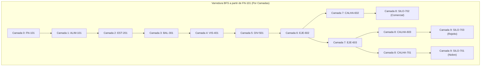

# Aula 13: Algoritmos de Busca (BFS e DFS) — Caminhos Mínimos e Varredura Topológica do Processo

**Projeto:** SCADA-Core Automática — GRUPO 4  
**Unidade Fabril:** Linha Automatizada de Seleção, Pesagem Dinâmica e Classificação Óptica de Grãos com Separação Pneumática Tripla  
**Referência Normativa:** ISA-5.1 & Teoria dos Grafos Aplicada à Engenharia de Automação e Sistemas Supervisórios  

---

## 1. Fundamentos Matemáticos: Busca em Grafos Dirigidos Industriais

Nos sistemas de automação de processos contínuos e discretos, a determinação de conectividade operacional, acessibilidade de atuadores a jusante e a identificação de caminhos ativos de transporte de produto requerem algoritmos formais de travessia e busca em grafos.

Dada a malha da planta modelada como um dígrafo ponderado $G = (V, E, W)$, onde $|V| = 14$ nós de equipamentos e $|E| = 14$ segmentos físicos de condução, definem-se os dois paradigmas fundamentais de busca:

### 1.1. Busca em Largura (*Breadth-First Search* — BFS)

A **Busca em Largura** explora a rede em camadas concêntricas a partir de um vértice de partida $s \in V$, expandindo sistematicamente todos os vizinhos a uma distância de salto $k$ antes de inspecionar qualquer nó a distância $k+1$.

* **Estrutura de Dados Subjacente:** Fila FIFO (*First-In, First-Out*).
* **Propriedade Matemática Central:**
  Para qualquer nó atingível $v \in V$, a árvore geradora de busca em largura induzida $T_{\text{BFS}}$ garante que o caminho entre $s$ e $v$ possui o **número estritamente mínimo de arestas (saltos topológicos)**:
  $$\delta_E(s, v) = \min \{ |\mathcal{P}| : \mathcal{P} \text{ é um caminho direcionado de } s \text{ para } v \}$$
* **Complexidade Temporal e Espacial:**
  Com representação por listas de adjacência, o tempo de execução é $O(|V| + |E|)$ e a ocupação em memória é $O(|V|)$.

#### Aplicação Operacional no SCADA:
1. **Determinação do Menor Número de Estágios de Chaveamento:** Identificação do trajeto que mobiliza a menor quantidade de equipamentos intermediários entre o funil de carga e os silos.
2. **Propagação de Intertravamentos e *Trips* em Cascata:** Quando um equipamento entra em falha crítica (ex.: sobrecarga `p_JI201` ou parada de emergência `p_EMERG`), o algoritmo BFS propaga instantaneamente o sinal de parada segura camada por camada a todos os nós a jusante.

---

### 1.2. Busca em Profundidade (*Depth-First Search* — DFS)

A **Busca em Profundidade** progride ao longo de um ramo direcionado o mais profundamente possível, avançando de vértice em vértice até atingir um nó sem sucessores não visitados (ou sumidouro), momento em que realiza o retrocesso (*backtracking*) para explorar ramos alternativos.

* **Estrutura de Dados Subjacente:** Pilha LIFO (*Last-In, First-Out*) ou recursão algorítmica.
* **Propriedades Estruturais e Classificação de Arestas:**
  A DFS atribui a cada vértice $v \in V$ dois carimbos de tempo de varredura:
  * Tempo de descoberta (*discovery time*): $d[v]$;
  * Tempo de finalização (*finish time*): $f[v]$.
  
  Pelo **Teorema do Parêntese**, para quaisquer nós $u, v$, os intervalos $[d[u], f[u]]$ e $[d[v], f[v]]$ são ou disjuntos ou estritamente contidos um no outro. As arestas do dígrafo são particionadas em:
  1. **Arestas de Árvore (*Tree Edges*):** Arestas que levam a vértices não visitados;
  2. **Arestas de Retorno (*Back Edges*):** Arestas $(u, v)$ que apontam para um ancestral $v$ na árvore DFS ($d[v] < d[u] < f[u] < f[v]$). **A presença de ao menos uma *back edge* é condição necessária e suficiente para a existência de ciclos no processo**;
  3. **Arestas de Avanço (*Forward Edges*):** Arestas que conectam um nó a um descendente não-imediato;
  4. **Arestas de Cruzamento (*Cross Edges*):** Arestas que conectam ramos distintos da floresta DFS.

#### Aplicação Operacional no SCADA:
1. **Detecção Formal de Linhas de Recirculação e Laços Fechados:** Identificação inequívoca de circuitos de recirculação de produto (como o elevador de canecas $e_{14}$ entre `SILO-702` e `FN-101`), prevenindo condições de *deadlock* e acúmulo infinito de sólidos.
2. **Ordenação Topológica (*Topological Sort*):** Para grafos acíclicos (quando a linha de reciclo está bloqueada por válvula `XV-104`), a ordenação decrescente de $f[v]$ gera a sequência estrita de energização e partida ordenada dos equipamentos (*sequenciamento de partida industrial*).

---

## 2. Diagrama Conceitual de Árvores de Busca

---

## 3. Comparativo Teórico Rigoroso: BFS versus DFS no Controle de Processos

| Dimensão de Engenharia | Busca em Largura (BFS) | Busca em Profundidade (DFS) |
| :--- | :--- | :--- |
| **Estrutura de Dados** | Fila FIFO (`collections.deque`) | Pilha LIFO (`list.append/pop` ou chamada recursiva) |
| **Garantia de Otimização** | Caminho com **menor número de trechos/saltos ($h_{\min}$)** | Não garante menor caminho; encontra qualquer trajetória válida |
| **Detecção de Ciclos** | Indireta (via nós cinzas na fronteira) | Direta e canônica (via identificação de **Back Edges**) |
| **Consumo de Memória** | Proporcional à largura máxima da malha ($O(b^d)$) | Proporcional à profundidade máxima do grafo ($O(d)$) |
| **Uso no Supervisório SCADA** | Localização de rotas com menor tempo de chaveamento; intertravamento em onda | Rastreamento completo de rotas alternativas e ordenação de partida |
| **Tratamento de Pesos ($W$)** | Válido apenas para grafos com pesos unitários ($w=1$) | Independente de pesos estruturais |

---

## 4. Análise de Acessibilidade e Trajetórias Operacionais

A partir do nó de recepção primária $v_1$ (`FN-101_Recepcao`), a aplicação de busca direcionada revela três caminhos produtivos elementares e um circuito de reciclo:

1. **Rota Nobre (Categoria A — Silo 701):**
   $$\mathcal{P}_A = (v_1 \rightarrow v_2 \rightarrow v_3 \rightarrow v_4 \rightarrow v_5 \rightarrow v_6 \rightarrow v_7 \rightarrow v_8 \rightarrow v_{11} \rightarrow v_{12})$$
   * Comprimento em saltos: 9 arestas.
   * Comprimento físico métrico: $1.2 + 1.8 + 2.5 + 3.0 + 1.0 + 2.0 + 1.5 + 2.2 + 3.5 = 18.7\text{ m}$.

2. **Rota Secundária (Categoria B — Silo 702):**
   $$\mathcal{P}_B = (v_1 \rightarrow v_2 \rightarrow v_3 \rightarrow v_4 \rightarrow v_5 \rightarrow v_6 \rightarrow v_7 \rightarrow v_9 \rightarrow v_{13})$$
   * Comprimento em saltos: 8 arestas.
   * Comprimento físico métrico: $1.2 + 1.8 + 2.5 + 3.0 + 1.0 + 2.0 + 0.8 + 4.0 = 16.3\text{ m}$.

3. **Rota de Rejeito (Categoria C — Silo 703):**
   $$\mathcal{P}_C = (v_1 \rightarrow v_2 \rightarrow v_3 \rightarrow v_4 \rightarrow v_5 \rightarrow v_6 \rightarrow v_7 \rightarrow v_8 \rightarrow v_{10} \rightarrow v_{14})$$
   * Comprimento em saltos: 9 arestas.
   * Comprimento físico métrico: $1.2 + 1.8 + 2.5 + 3.0 + 1.0 + 2.0 + 1.5 + 0.8 + 3.2 = 17.0\text{ m}$.

4. **Circuito de Reciclo / Reteste:**
   Quando a válvula $e_{14}$ (`XV-104`) está aberta, o retorno de $v_{13}$ para $v_1$ fecha o ciclo:
   $$\mathcal{C}_{\text{reciclo}} = (\mathcal{P}_B \cup \{e_{14}\})$$
   A DFS detecta a aresta $e_{14} = (v_{13}, v_1)$ como uma **Back Edge**, pois $v_1$ é o ancestral de origem na pilha de execução.

---

## 5. Exemplo Resolvido Passo a Passo

### Rastreamento Manual do Algoritmo BFS a partir do Nó `DIV-501_Decisao`

**Enunciado:**  
Considere que um lote de grãos atingiu o nó de decisão lógica `DIV-501_Decisao` ($v_6$). Execute a simulação passo a passo do algoritmo BFS para identificar todos os silos atingíveis e seus respectivos números mínimos de saltos.

**Resolução:**

1. **Inicialização:**
   * Fila FIFO: $Q = [v_6]$
   * Visitados: $\{v_6\}$
   * Distâncias em saltos: $\text{dist}[v_6] = 0$
   * Antecessores: $\text{pai}[v_6] = \text{null}$

2. **Iteração 1:**
   * Desenfileira $u = v_6$ (`DIV-501_Decisao`).
   * Sucessores direcionados de $v_6$: $\{v_7\}$ (`EJE-602_EstacaoB`).
   * $v_7$ não visitado: marca visitado, $\text{dist}[v_7] = 1$, $\text{pai}[v_7] = v_6$, insere em $Q$.
   * Fila: $Q = [v_7]$

3. **Iteração 2:**
   * Desenfileira $u = v_7$ (`EJE-602_EstacaoB`).
   * Sucessores de $v_7$: $\{v_9, v_8\}$ (`CALHA-602_Secundario`, `EJE-603_EstacaoC`).
   * $v_9$ não visitado: $\text{dist}[v_9] = 2$, $\text{pai}[v_9] = v_7$, insere em $Q$.
   * $v_8$ não visitado: $\text{dist}[v_8] = 2$, $\text{pai}[v_8] = v_7$, insere em $Q$.
   * Fila: $Q = [v_9, v_8]$

4. **Iteração 3:**
   * Desenfileira $u = v_9$ (`CALHA-602_Secundario`).
   * Sucessores de $v_9$: $\{v_{13}\}$ (`SILO-702_Secundario`).
   * $v_{13}$ não visitado: $\text{dist}[v_{13}] = 3$, $\text{pai}[v_{13}] = v_9$, insere em $Q$.
   * Fila: $Q = [v_8, v_{13}]$

5. **Iteração 4:**
   * Desenfileira $u = v_8$ (`EJE-603_EstacaoC`).
   * Sucessores de $v_8$: $\{v_{10}, v_{11}\}$ (`CALHA-603_Rejeito`, `CALHA-701_Terminal`).
   * $v_{10}$ não visitado: $\text{dist}[v_{10}] = 3$, $\text{pai}[v_{10}] = v_8$, insere em $Q$.
   * $v_{11}$ não visitado: $\text{dist}[v_{11}] = 3$, $\text{pai}[v_{11}] = v_8$, insere em $Q$.
   * Fila: $Q = [v_{13}, v_{10}, v_{11}]$

6. **Iteração 5:**
   * Desenfileira $u = v_{13}$ (`SILO-702_Secundario`).
   * Sucessor de $v_{13}$ com reciclo ativo: $v_1$ (`FN-101_Recepcao`). $\text{dist}[v_1] = 4$.
   * Sem reciclo ($e_{14}$ bloqueado): grau de saída 0 (sumidouro terminal).
   * Fila: $Q = [v_{10}, v_{11}]$

7. **Iteração 6 e 7:**
   * Desenfileira $v_{10} \rightarrow$ descobre $v_{14}$ (`SILO-703_Rejeito`) com $\text{dist}[v_{14}] = 4$.
   * Desenfileira $v_{11} \rightarrow$ descobre $v_{12}$ (`SILO-701_Aprovados`) com $\text{dist}[v_{12}] = 4$.

**Conclusão Operacional:**
* O Silo B (`SILO-702`) é atingido com **3 saltos**, sendo o destino mais próximo a partir da decisão lógica;
* Os Silos A e C são atingidos com **4 saltos**;
* Esse escalonamento fundamenta a temporização dos registradores de deslocamento (*shift registers*) `ZC-602` e `ZC-603` do CLP.

---

## 6. Atividades de Investigação e Desafios de Engenharia

1. **Intertravamento de Rota Ativa por Falha no Bocal B:**
   Se a válvula solenóide `FY-602` falhar aberta ou o pistão travar (`p_FALHA_EJETOR = 1`), a aresta $e_7$ torna-se inoperante. Utilize o algoritmo BFS para comprovar se a rota para o `SILO-701_Aprovados` permanece conexa e se é possível reencaminhar o material nobre sem descarte forçado.
2. **Propagação de Alarme em Malha Fechada:**
   Considerando o circuito com reciclo ativo ($e_{14}$ operacional), mostre como o algoritmo DFS identifica o laço infinito e impede que rotinas de cálculo de vazão acumulada entrem em *overflow* de recursão.
3. **Ordenação Topológica com e sem Recirculação:**
   Demonstre matematicamente por que um grafo com ciclos não admite ordenação topológica. Como o SCADA deve desacoplar o arco de reciclo $e_{14}$ para gerar a sequência ótima de ligamento dos motores na partida fria da fábrica?

---

## 7. Entregável da Aula 13

* **Módulo de Busca e Rastreamento de Caminhos em Python:** Desenvolvido no Jupyter Notebook correspondente (`13 - Algoritmos de Busca (BFS e DFS).ipynb`), contendo:
  1. A classe `BuscadorTopologico` com os métodos canônicos `busca_largura_bfs` e `busca_profundidade_dfs`;
  2. Rastreamento e reconstrução dos caminhos ativos do funil até os três silos;
  3. Classificação formal das arestas (Tree, Back, Forward e Cross Edges) e teste automatizado de aciclicidade;
  4. Mapeamento de alcance para intertravamento em cascata e visualização tabular dos tempos $d[v]$ e $f[v]$.
