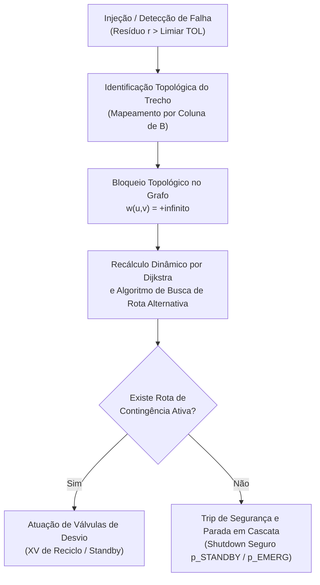

# Aula 15: Simulação de Vazamentos e Injeção de Falhas — Teste de Estresse em Malha Fechada e Desvio Automático

**Projeto:** SCADA-Core Automática — GRUPO 4  
**Unidade Fabril:** Linha Automatizada de Seleção, Pesagem Dinâmica e Classificação Óptica de Grãos com Separação Pneumática Tripla  
**Referência Normativa:** ISA-5.1 & Detecção de Falhas e Tolerância Topológica em Sistemas Supervisórios  

---

## 1. Fundamentos Matemáticos: Injeção de Falhas e Detecção de Anomalias em Grafos

Sistemas industriais modernos de alta confiabilidade não devem apenas operar em condições nominais ideais, mas sim responder com estabilidade comprovada diante de distúrbios físicos severos.

Na planta de classificação óptica e pesagem contínua, os dois distúrbios críticos de processo são:
1. **Vazamento e Perda de Material Granular (Quebra de Conservação Mássica):**
   Rompimento de tubulação, rasgo na correia da esteira ou falha em vedação de comportas. Matematicamente, introduz-se um termo dissipativo $\vec{\epsilon} \in \mathbb{R}^n$:
   $$B \cdot \vec{Q} = \vec{S} + \vec{\epsilon}$$
   Onde $\epsilon_i > 0$ representa a taxa de vazamento no nó $v_i$. O vetor residual de alarme é formalmente calculado por:
   $$\vec{r} = B \cdot \vec{Q}_{\text{medido}} - \vec{S}_{\text{esperado}} \neq \vec{0}$$
2. **Obstrução Física e Falha Atuadora (Degradação de Aresta):**
   Entupimento de duto, sobrepressão ou queima de bobina solenoide (`FY-602` ou `FY-603`). Modela-se a perda da aresta $e_k = (u, v)$ anulando sua capacidade e aplicando peso infinito:
   $$w(u, v) \leftarrow +\infty$$

---

## 2. Arquitetura do Motor de Desvio Automático e Resiliência em Malha Fechada

Quando uma anomalia é detectada pelo SCADA, o motor em malha fechada executa o ciclo de controle em 4 etapas:

---

## 3. Cenários de Teste de Estresse Simulados

Para homologar a robustez do software supervisório, foram parametrizados quatro cenários rigorosos de teste:

1. **Cenário 1 — Vazamento Dinâmico na Esteira de Pesagem ($e_3$):**
   Perda progressiva de $150\text{ kg/h}$ entre a entrada `EST-201` e a balança `BAL-301` por rasgo mecânico de lona.
2. **Cenário 2 — Obstrução Total por Umidade na Calha B ($e_{12}$):**
   Entupimento na descida para `SILO-702`. A vazão cai a zero ($Q_{12} = 0$), provocando acúmulo no nó `CALHA-602` ($S_9 > 0$).
3. **Cenário 3 — Falha Crítica de Pistão Pneumático (`p_FALHA_EJETOR` em $e_7$):**
   O bocal pneumático Categoria B falha recuado. Os grãos comerciais não podem ser desviados na estação B e devem seguir para classificação de contingência.
4. **Cenário 4 — Inundação Simultânea de Silos (Estresse Extremo):**
   Nível crítico atingido concorrentemente nos Silos A e B (`p_NC701 = 1` e `p_NC702 = 1`). Validação do acionamento imediato da linha de reciclo $e_{14}$ (`XV-104`) ou corte do alimentador `c_ALIM`.

---

## 4. Exemplo Resolvido Passo a Passo

### Diagnóstico Algébrico do Vazamento na Estação de Pesagem

**Enunciado:**  
A alimentação no funil `FN-101` opera em $1200\text{ kg/h}$ nominais. A balança dinâmica `WT-301` registra uma taxa estável de apenas $1050\text{ kg/h}$. Demonstre como o produto matricial $B \cdot \vec{Q}$ isola exatamente o nó afetado e o volume de perda.

**Resolução:**

1. **Vetor de Vazões com Degradação:**
   * $Q(e_1) = 1200\text{ kg/h}$
   * $Q(e_2) = 1200\text{ kg/h}$
   * Trecho com vazamento mecânico $e_3$: $Q(e_3) = 1050\text{ kg/h}$
2. **Cálculo da Linha $i = 3$ (`EST-201_Entrada`):**
   $$(B \cdot \vec{Q})_3 = +Q(e_2) - Q(e_3) = 1200 - 1050 = \mathbf{+150\text{ kg/h}}$$
3. **Cálculo da Linha $i = 4$ (`BAL-301_Pesagem`):**
   $$(B \cdot \vec{Q})_4 = +Q(e_3) - Q(e_4) = 1050 - 1050 = 0\text{ kg/h}$$

**Conclusão do Diagnóstico:**
O desbalanço positivo de $+150\text{ kg/h}$ localizado estritamente na linha do nó `EST-201` prova de forma unívoca que a perda ocorre na saída física deste nó (aresta $e_3$). O SCADA emite o alarme com precisão cirúrgica de localização física e quantificação de perda em tempo real.

---

## 5. Atividades de Investigação e Desafios de Engenharia

1. **Margem de Ruído em Instrumentação Industrial:**
   Em uma planta real, transmissores de célula de carga (`WT-301`) e medidores ópticos possuem ruído Gaussiano inerente ($\pm 2\%$). Como implementar uma banda morta (*deadband*) no cálculo do resíduo $r_i$ para evitar alarmes falsos de vazamento sem comprometer a sensibilidade de detecção?
2. **Tempo Crítico de Resposta para Transbordo:**
   Sabendo que a calha gravitacional comporta no máximo $15\text{ kg}$ antes de transbordar na correia, quanto tempo o CLP dispõe para cortar o alimentador `c_ALIM` diante de uma obstrução total com vazão afluente de $180\text{ kg/h}$?
3. **Comportamento em Falha Dupla Concorrente:**
   Analise a resiliência da malha caso ocorra simultaneamente a quebra da esteira transportadora ($e_3$) e o travamento do elevador de reciclo ($e_{14}$). Mostre por que a única saída segura é a parada de emergência total da planta.

---

## 6. Entregável da Aula 15

* **Módulo de Injeção de Falhas e Teste de Estresse em Python:** Desenvolvido no Jupyter Notebook correspondente (`15 - Simulação de Vazamentos.ipynb`), contendo:
  1. A classe `SimuladorVazamentosFalhas` integrando a Matriz de Incidência $B$ e o algoritmo de Dijkstra;
  2. Implementação dos 4 cenários industriais de estresse com emissão de relatórios diagnósticos;
  3. Matriz de resíduos mássicos e cálculo automático de isolamento de falha;
  4. Validação da tolerância a falhas e protocolo de desvio automático em tempo real.
