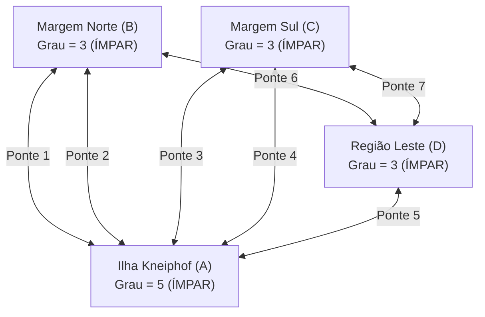
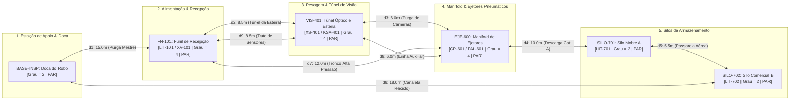

# Aula 16: Problemas Eulerianos e Inspeção Autônoma da Infraestrutura da Planta

**Projeto:** SCADA-Core Automática — GRUPO 4  
**Unidade Fabril:** Linha Automatizada de Seleção, Pesagem Dinâmica e Classificação Óptica de Grãos com Separação Pneumática Tripla  
**Referência Normativa:** ISA-5.1 & Teoria dos Grafos Aplicada à Manutenção Preditiva e Inspeção Não-Destrutiva  

---

## 1. Fundamentos Matemáticos: Teorema de Euler e Circuitos Eulerianos

Na engenharia de confiabilidade e automação de plantas industriais de processamento de grãos, a manutenção preventiva e preditiva de dutos, galerias de cabos e calhas pneumáticas exige a verificação estrutural periódica de 100% das vias de transporte. O objetivo ótimo de uma rotina de inspeção automatizada é **percorrer cada segmento físico de tubulação exatamente uma vez**, eliminando o consumo desnecessário de bateria de robôs autônomos, tempo improdutivo de máquina parada (*downtime*) e desgaste dos instrumentos de sensoriamento.

Esse desafio é a transposição direta do conceito clássico de **Circuito Euleriano** da Teoria dos Grafos.

### 1.1. Definições Formais e Terminologia

Seja $G = (V, E)$ um grafo finito, conexo e não-dirigido (ou multigrafo, admitindo arestas paralelas), onde $V$ representa o conjunto de nós (estações de processo, bifurcações e silos) e $E$ representa o conjunto de arestas (dutos de ar comprimido, galerias de esteira e calhas gravitacionais).

* **Passeio (*Walk*):** Uma sequência alternada finita de vértices e arestas $v_0, e_1, v_1, e_2, \dots, e_k, v_k$, tal que cada aresta $e_i = \{v_{i-1}, v_i\} \in E$.
* **Trilha (*Trail*):** Um passeio no qual **nenhuma aresta se repete**. Vértices podem ser visitados múltiplas vezes.
* **Circuito (*Circuit*):** Uma trilha fechada, isto é, onde o vértice de partida coincide com o vértice final ($v_0 = v_k$).
* **Circuito Euleriano (*Eulerian Circuit*):** Um circuito que contém **todas as arestas de $E$ exatamente uma vez**. Um grafo que admite tal circuito é denominado **Grafo Euleriano**.
* **Trilha Euleriana (*Eulerian Trail*):** Uma trilha aberta que percorre todas as arestas de $E$ exatamente uma vez, iniciando em um nó $u$ e terminando em um nó distinto $v \neq u$.

---

### 1.2. Teorema Fundamental de Euler (1736)

> **Teorema (Euler, 1736):**  
> Um grafo conexo $G = (V, E)$ admite um circuito euleriano se e somente se **todos os seus vértices possuem grau par**:
> $$\deg(v) \equiv 0 \pmod 2 \quad (\forall v \in V)$$

#### Demonstração Formal:

1. **Condição Necessária ($\implies$):**  
   Suponha que $G$ possui um circuito euleriano $C = (v_0, e_1, v_1, \dots, e_m, v_0)$. Cada ocorrência de um vértice intermediário $v \in V \setminus \{v_0\}$ ao longo de $C$ consome necessariamente duas arestas incidentes distintas: uma aresta de chegada e uma aresta de partida. Para o vértice inicial/final $v_0$, a aresta de partida inicial $e_1$ emparelha-se com a aresta de chegada final $e_m$, e quaisquer outras visitas intermediárias a $v_0$ também consomem arestas aos pares. Como $C$ esgota todas as arestas de $G$ sem repeti-las, cada vértice $v$ incide em exatamente $2k_v$ arestas distintas (onde $k_v$ é o número de passagens de $C$ por $v$). Portanto, $\deg(v) = 2k_v$, provando que o grau de todo vértice é obrigatoriamente par.

2. **Condição Suficiente ($\impliedby$, Demonstração Construtiva):**  
   Suponha que $G$ é conexo e $\deg(v)$ é par para todo $v \in V$.  
   * Como $\deg(v) \geq 2$ para todo $v$ (caso não haja vértices isolados), partindo de um nó qualquer $u$, podemos construir uma trilha fechada simples $C_1$: ao entrar em qualquer vértice $w$, como o grau original era par e já utilizamos uma aresta para entrar, resta pelo menos uma aresta incidente não utilizada para sair. O processo só é obrigado a parar quando retornamos ao nó inicial $u$.
   * Se $C_1$ contiver todas as arestas de $E$, o circuito está completo.
   * Caso contrário, removemos as arestas de $C_1$ de $G$, obtendo um subgrafo remanescente $G'$. Como $C_1$ utilizou um número par de arestas em cada vértice visitado, todos os vértices de $G'$ ainda conservam grau par.
   * Pela conexidade de $G$, existe pelo menos um vértice $v^* \in C_1$ que possui arestas incidentes em $G'$. Partindo de $v^*$, construímos um novo ciclo fechado $C_2$ em $G'$.
   * "Costuramos" (*splice*) o ciclo $C_2$ no ponto $v^*$ de $C_1$.
   * Repetindo esse procedimento indutivamente até que todas as arestas de $E$ sejam consumidas, obtém-se um circuito euleriano unificado. $\blacksquare$

---

### 1.3. O Lema do Aperto de Mãos (*Handshaking Lemma*)

Em qualquer grafo não-dirigido $G = (V, E)$, cada aresta $e = \{u, v\}$ contribui com $+1$ para o grau de $u$ e $+1$ para o grau de $v$. Logo:

$$\sum_{v \in V} \deg(v) = 2 |E|$$

**Corolário Imediato:** A soma dos graus de todos os vértices é sempre um número par. Consequentemente, **o número de vértices com grau ímpar em qualquer grafo é obrigatoriamente par**.

---

## 2. Aprofundamento Teórico

### 2.1. Contexto Histórico: O Problema das Sete Pontes de Königsberg

Em 1736, o matemático suíço Leonhard Euler publicou *"Solutio problematis ad geometriam situs pertinentis"*, considerado a certidão de nascimento da Teoria dos Grafos e da Topologia.

Na cidade prussiana de Königsberg (atual Kaliningrado), o rio Pregel dividia a cidade em quatro regiões de terra firme ($A, B, C, D$), interligadas por sete pontes:
* Região central da ilha de Kneiphof ($A$): 5 pontes incidentes ($\deg(A) = 5$);
* Margem Norte ($B$): 3 pontes incidentes ($\deg(B) = 3$);
* Margem Sul ($C$): 3 pontes incidentes ($\deg(C) = 3$);
* Região leste bifurcada ($D$): 3 pontes incidentes ($\deg(D) = 3$).

A população se perguntava se era possível realizar um passeio a pé que cruzasse cada ponte exatamente uma vez e retornasse ao ponto de partida. Euler abstraiu a geografia em vértices e as pontes em arestas e provou analiticamente a **impossibilidade**: para um circuito euleriano existir, todos os 4 vértices deveriam ter grau par; entretanto, todos os 4 possuíam grau ímpar ($5, 3, 3, 3$).



> **Conclusão de Euler:** Nenhuma trilha euleriana (nem fechada nem aberta) existe em Königsberg, pois há quatro vértices ímpares (uma trilha aberta exige no máximo dois).

---

### 2.2. Adaptação para Grafos Dirigidos (Dígrafos)

Em um dígrafo $D = (V, E)$, cada vértice possui um grau de emissão ($\deg^+(v)$, arcos que saem) e um grau de recepção ($\deg^-(v)$, arcos que entram).

> **Teorema de Euler para Dígrafos:**  
> Um dígrafo fracamente conexo admite um circuito euleriano se e somente se:
> $$\deg^+(v) = \deg^-(v) \quad (\forall v \in V)$$
> Ou seja, todo vértice deve apresentar **balanço de fluxo de arestas estritamente nulo**.

**Por que a Malha de Inspeção da Planta de Grãos é Modelada como Grafo Não-Dirigido?**  
Nas Aulas 11 a 15, o escoamento contínuo de grãos de arroz e o sopro pneumático de ejeção foram modelados como **dígrafos orientados**, pois os grãos fluem estritamente no sentido montante $\to$ jusante (gravidade e tração de correia).  
Contudo, para a **inspeção autônoma de infraestrutura** (Aula 16), o robô de manutenção (crawler magnético de dutos ou sensor ultrassônico sobre trilho guia) trafega livremente em **ambos os sentidos** dentro de uma calha ou duto despressurizado. A varredura de trincas, medição de espessura de parede por ultrassom e limpeza de poeira ATEX são idênticas independentemente da direção de avanço do robô. Assim, a malha de inspeção é formalmente tratada como um **Grafo Não-Dirigido**.

---

### 2.3. O Algoritmo de Hierholzer (1873) — Análise Detalhada

O **Algoritmo de Hierholzer** constrói um circuito euleriano de forma determinística utilizando uma estratégia elegante baseada em **pilha explícita (*stack*) e remoção de arestas visitadas**.

#### Passo a Passo Algorítmico:
1. **Inicialização:** Seleciona um vértice inicial arbitrário $s \in V$. Inicializa a pilha com `pilha = [s]` e a lista de saída `circuito = []`.
2. **Varredura e Avanço:**
   * Seja $u = \text{pilha.topo()}$.
   * Se $u$ ainda possui arestas incidentes não visitadas na lista de adjacência, seleciona uma aresta $\{u, v\}$, remove-a de $G$ (eliminando de `adj[u]` e de `adj[v]`), e empilha o vizinho $v$ (`pilha.append(v)`).
3. **Retrocesso e Costura:**
   * Se $u$ não possui mais arestas disponíveis não visitadas, $u$ completou seu ciclo local e não pode avançar mais. Desempilha $u$ e o insere no circuito (`circuito.append(pilha.pop())`).
4. **Finalização:**
   * O processo termina quando a pilha estiver vazia. O circuito final é obtido invertendo a lista `circuito` (já que os vértices foram adicionados de trás para frente no desempilhamento).

#### Complexidade Computacional:
* **Tempo:** $O(|E|)$ linear ótimo. Cada aresta é percorrida e removida da lista de adjacência exatamente uma vez ($O(1)$ por aresta com estruturas de lista ou conjunto). Cada vértice entra e sai da pilha proporcionalmente ao seu grau: $\sum \deg(v) = 2|E|$.
* **Espaço:** $O(|V| + |E|)$ para armazenar a cópia das listas de adjacência e a pilha de recursão.

---

### 2.4. O Problema do Carteiro Chinês (*Chinese Postman Problem*)

Quando a infraestrutura de tubulações de uma planta industrial **não satisfaz a condição de Euler** (isto é, contém vértices de grau ímpar), é impossível percorrer todas as tubulações sem repetir trechos.

O problema de encontrar o percurso fechado de **menor custo total** que atravesse todas as arestas pelo menos uma vez é denominado **Problema do Carteiro Chinês** (proposto pelo matemático chinês Kwan Mei-Ko em 1962).

#### Procedimento Ótimo de Resolução Polinomial:
1. **Identificação de Vértices Ímpares:** Encontra o conjunto $V_{\text{ímpar}} = \{v \in V \mid \deg(v) \text{ é ímpar}\}$. Pelo Lema do Aperto de Mãos, $|V_{\text{ímpar}}|$ é sempre um número par ($2k$).
2. **Cálculo de Distâncias Mínimas:** Para cada par de vértices em $V_{\text{ímpar}}$, calcula o menor caminho métrico entre eles usando o **Algoritmo de Dijkstra** (estudado na Aula 14).
3. **Emparelhamento Perfeito de Custo Mínimo (*Minimum Weight Perfect Matching*):** Encontra a partição dos vértices ímpares em pares disjuntos que minimize a soma das distâncias mínimas. Essa etapa é solucionada em tempo polinomial $O(|V|^3)$ pelo **Algoritmo de Blossom** de Jack Edmonds (1965).
4. **Eulerianização do Grafo:** Para cada par emparelhado, duplica as arestas que compõem o menor caminho correspondente na malha original. O multigrafo resultante possui todos os vértices com grau par!
5. **Execução de Hierholzer:** Executa o Algoritmo de Hierholzer no grafo duplicado, obtendo a rota de inspeção com custo estritamente mínimo.

---

## 3. Modelagem Topológica da Malha de Inspeção da Planta de Grãos (Grupo 4)

### 3.1. Contexto Industrial: Manutenção Preditiva e Risco de Poeira Explosiva (ATEX)

Na planta de seleção e classificação óptica de grãos de arroz do **Grupo 4**:
* O atrito contínuo dos grãos de arroz nas calhas metálicas provoca desgaste abrasivo e adelgaçamento de chapa;
* A rede de ar comprimido a $6{,}0\text{ bar}$ (alimentada pelo compressor `CP-601` e monitorada por `PAL-601`) sofre fadiga mecânica cíclica decorrente dos disparos em alta velocidade dos ejetores `FY-602` e `FY-603`;
* O transporte de grãos gera partículas finas de farelo e pó de amido de arroz. O acúmulo desse pó suspenso em dutos representa grave risco de explosão orgânica (classificação de área **ATEX / IECEx Zona 20/21** e **NR-12/NR-33**).

Para garantir a operação segura, um **robô autônomo de inspeção ultrassônica e limpeza** parte da doca de recarga (`BASE-INSP`), percorre todos os 9 dutos e galerias técnicas da fábrica e retorna à base.

---

### 3.2. Vértices da Malha de Inspeção ($|V| = 6$)

| Identificador | Equipamento da Planta | Descrição Funcional e Sensores ISA-5.1 |
| :---: | :--- | :--- |
| `BASE-INSP` | Doca de Manutenção e Recarga | Estação base de calibração, recarga indutiva e descarregamento de dados de inspeção. |
| `FN-101` | Funil de Recepção | Conjunto funil de entrada, comporta guilhotina `XV-101` e sensor de nível contínuo `LIT-101`. |
| `VIS-401` | Túnel Óptico e Esteira | Seção combinada da correia `EST-201`, mesa de pesagem `BAL-301` e câmeras de alta resolução `VIS-401`. |
| `EJE-600` | Manifold Pneumático e Ejetores | Manifold de ar comprimido alimentado por `CP-601`, pressostato `PAL-601` e válvulas rápidas `FY-602`/`FY-603`. |
| `SILO-701` | Silo de Grãos Nobres (Cat. A) | Silo de estocagem de arroz aprovado tipo 1, sensor `LIT-701` e válvula borboleta `XV-701`. |
| `SILO-702` | Silo de Grãos Comerciais (Cat. B) | Silo secundário, calha de reciclo `EL-101`, sensor `LIT-702` e comporta `XV-702`. |

---

### 3.3. Arestas e Dutos Físicos de Inspeção ($|E| = 9$)

Cada trecho de tubulação/galeria é bidirecional para a varredura do robô:

| Duto | Origem / Destino | Descrição da Infraestrutura Física | Comprimento $L$ [m] | Diâmetro / Perfil |
| :---: | :---: | :--- | :---: | :---: |
| $d_1$ | `BASE-INSP` $\longleftrightarrow$ `FN-101` | Galeria de duto mestre de pressurização e purga de entrada | 15.0 m | DN150 Aço Carbono |
| $d_2$ | `FN-101` $\longleftrightarrow$ `VIS-401` | Túnel técnico sob calha vibratória `ALIM-101` e esteira `EST-201` | 8.5 m | Canaleta Blindada |
| $d_3$ | `VIS-401` $\longleftrightarrow$ `EJE-600` | Duto condutor de ar de purga da lente óptica e trigger | 6.0 m | DN100 Inox 304 |
| $d_4$ | `EJE-600` $\longleftrightarrow$ `SILO-701` | Tubulação aérea de descarga terminal gravitacional Cat. A | 10.0 m | DN200 Aço Carbono |
| $d_5$ | `SILO-701` $\longleftrightarrow$ `SILO-702` | Passarela técnica de interligação dos topos dos silos | 5.5 m | Galeria Aérea |
| $d_6$ | `SILO-702` $\longleftrightarrow$ `BASE-INSP` | Canaleta do elevador de reciclo `EL-101` até a base | 18.0 m | Duto Vertical/Subsolo |
| $d_7$ | `FN-101` $\longleftrightarrow$ `EJE-600` | Linha pneumática tronco de alta pressão do compressor `CP-601` | 12.0 m | Tubo Schedule 80 |
| $d_8$ | `EJE-600` $\longleftrightarrow$ `VIS-401` | Linha redundante de ar comprimido para limpeza de lentes | 6.0 m | DN50 Inox 316 |
| $d_9$ | `VIS-401` $\longleftrightarrow$ `FN-101` | Duto auxiliar de retroalimentação e cabeamento redundante | 8.5 m | Eletrocalha Selada |

---

### 3.4. Fluxograma Operacional do Ciclo de Inspeção e Topologia da Malha

#### A. Fluxograma Operacional da Rotina de Inspeção Autônoma (CLP / SCADA)

```mermaid
flowchart TD
    Inicio([Início da Missão de Inspeção: Robô Acoplado na BASE-INSP]) --> Checagem{CLP & SCADA:\nTodos os vértices da\nmalha têm grau par?}
    Checagem -- Não --> Bloqueio([Alarme de Falha Estrutural:\nVértices Ímpares Detectados\nDisparar Rotina do Carteiro Chinês])
    Checagem -- Sim --> Hierholzer[Executar Algoritmo de Hierholzer em O(|E|)\nGerar Trilha Fechada Ótima: d1 até d9]
    
    Hierholzer --> P1["1. Duto d1 (15.0m): BASE-INSP → FN-101\nVarredura da Galeria Mestre de Purga e Pressurização"]
    P1 --> P2["2. Duto d2 (8.5m): FN-101 → VIS-401\nVarredura do Túnel sob Calha ALIM-101 e Esteira EST-201"]
    P2 --> P3["3. Duto d3 (6.0m): VIS-401 → EJE-600\nVarredura do Duto de Ar de Purga e Trigger Óptico"]
    P3 --> P4["4. Duto d8 (6.0m): EJE-600 → VIS-401\nVarredura da Linha Redundante de Ar das Lentes"]
    P4 --> P5["5. Duto d9 (8.5m): VIS-401 → FN-101\nVarredura do Duto Auxiliar de Retroalimentação"]
    P5 --> P6["6. Duto d7 (12.0m): FN-101 → EJE-600\nVarredura da Linha Tronco de Alta Pressão CP-601"]
    P6 --> P7["7. Duto d4 (10.0m): EJE-600 → SILO-701\nVarredura da Tubulação Aérea de Descarga Cat. A"]
    P7 --> P8["8. Duto d5 (5.5m): SILO-701 → SILO-702\nVarredura da Passarela Técnica entre Silos"]
    P8 --> P9["9. Duto d6 (18.0m): SILO-702 → BASE-INSP\nVarredura da Canaleta do Elevador de Reciclo EL-101"]
    
    P9 --> Fim([Fim da Missão: 89.5m Inspecionados\n100% de Cobertura sem Redundância de Dutos\nAcoplamento e Recarga Indutiva na Doca])
```

#### B. Diagrama Topológico da Malha de Dutos (Subgrafos por Área do Processo)



---

## 4. Análise de Paridade e Verificação do Teorema de Euler

Contabilizando as incidências para cada nó da malha:

* $\deg(\text{BASE-INSP}) = 2$ incidentes: $\{d_1, d_6\} \implies$ **PAR**
* $\deg(\text{FN-101}) = 4$ incidentes: $\{d_1, d_2, d_7, d_9\} \implies$ **PAR**
* $\deg(\text{VIS-401}) = 4$ incidentes: $\{d_2, d_3, d_8, d_9\} \implies$ **PAR**
* $\deg(\text{EJE-600}) = 4$ incidentes: $\{d_3, d_4, d_7, d_8\} \implies$ **PAR**
* $\deg(\text{SILO-701}) = 2$ incidentes: $\{d_4, d_5\} \implies$ **PAR**
* $\deg(\text{SILO-702}) = 2$ incidentes: $\{d_5, d_6\} \implies$ **PAR**

### 4.1. Verificação do Lema do Aperto de Mãos:
$$\sum_{v \in V} \deg(v) = 2 + 4 + 4 + 4 + 2 + 2 = 18 = 2 \times |E| = 2 \times 9 = 18 \quad \text{[CONSISTENTE]}$$

Como o grafo é comprovadamente conexo e **todos os 6 vértices possuem grau par**, o Teorema de Euler garante a existência de pelo menos um **Circuito Euleriano Fechado**!

---

## 5. Exemplo Resolvido: Rastreamento Passo a Passo do Algoritmo de Hierholzer

**Objetivo:** Obter a rota exata de inspeção do robô partindo de `BASE-INSP` e retornando a `BASE-INSP`, cobrindo todos os 9 dutos sem repetir nenhum trecho.

### Rastreamento da Execução:
1. `pilha = [BASE-INSP]`. O nó possui as arestas $\{d_1, d_6\}$. Avança por $d_1$ até `FN-101`.  
   `pilha = [BASE-INSP, FN-101]`. Aresta $d_1$ é consumida.
2. `FN-101` avança por $d_7$ até `EJE-600`.  
   `pilha = [BASE-INSP, FN-101, EJE-600]`. Aresta $d_7$ consumida.
3. `EJE-600` avança por $d_4$ até `SILO-701`.  
   `pilha = [BASE-INSP, FN-101, EJE-600, SILO-701]`. Aresta $d_4$ consumida.
4. `SILO-701` avança por $d_5$ até `SILO-702`.  
   `pilha = [BASE-INSP, FN-101, EJE-600, SILO-701, SILO-702]`. Aresta $d_5$ consumida.
5. `SILO-702` avança por $d_6$ até `BASE-INSP`.  
   `pilha = [BASE-INSP, FN-101, EJE-600, SILO-701, SILO-702, BASE-INSP]`. Aresta $d_6$ consumida.
6. Em `BASE-INSP`, não restam mais arestas livres incidentes! Desempilha:  
   `circuito = [BASE-INSP]`. Topo agora é `SILO-702`.
7. `SILO-702` sem arestas livres $\implies$ desempilha: `circuito = [BASE-INSP, SILO-702]`.
8. `SILO-701` sem arestas livres $\implies$ desempilha: `circuito = [BASE-INSP, SILO-702, SILO-701]`.
9. Topo é `EJE-600`. `EJE-600` ainda possui as arestas livres $d_3$ e $d_8$! Avança por $d_8$ até `VIS-401`.  
   `pilha = [..., EJE-600, VIS-401]`.
10. `VIS-401` avança por $d_9$ até `FN-101`.  
    `pilha = [..., EJE-600, VIS-401, FN-101]`.
11. `FN-101` avança pela última aresta livre incidente, $d_2$, até `VIS-401`.  
    `pilha = [..., EJE-600, VIS-401, FN-101, VIS-401]`.
12. `VIS-401` avança por $d_3$ de volta para `EJE-600`.  
    `pilha = [..., EJE-600, VIS-401, FN-101, VIS-401, EJE-600]`.
13. Agora todas as 9 arestas foram rigorosamente consumidas. Todos os nós restantes na pilha são sucessivamente desempilhados para a lista `circuito`.
14. Ao inverter a lista resultante, o circuito euleriano completo é:

$$\text{BASE-INSP} \xrightarrow{d_1} \text{FN-101} \xrightarrow{d_2} \text{VIS-401} \xrightarrow{d_3} \text{EJE-600} \xrightarrow{d_8} \text{VIS-401} \xrightarrow{d_9} \text{FN-101} \xrightarrow{d_7} \text{EJE-600} \xrightarrow{d_4} \text{SILO-701} \xrightarrow{d_5} \text{SILO-702} \xrightarrow{d_6} \text{BASE-INSP}$$

### Comprimento Total da Rota de Inspeção:
$$L_{\text{total}} = 15.0 + 8.5 + 6.0 + 6.0 + 8.5 + 12.0 + 10.0 + 5.5 + 18.0 = 89.5\text{ metros}$$

> **Resultado Notável:** O robô inspecionou $100\%$ da malha física ($89{,}5\text{ m}$) sem percorrer um único milímetro a mais do que o estritamente necessário.

---

## 6. Investigação do Problema do Carteiro Chinês na Planta

Suponha que durante uma expansão física da fábrica, um décimo duto de alívio rápido $d_{10}$ ($L = 14{,}0\text{ m}$) seja instalado interligando diretamente `SILO-702` a `VIS-401`:

1. **Alteração de Paridade:**
   * $\deg(\text{SILO-702})$ passa de $2$ para $3$ (**ÍMPAR**);
   * $\deg(\text{VIS-401})$ passa de $4$ para $5$ (**ÍMPAR**);
   * Os demais vértices permanecem pares.
2. **Diagnóstico Topológico:** O grafo **deixa de ser euleriano**, pois existem exatamente 2 vértices com grau ímpar.
3. **Resolução via Carteiro Chinês:**
   * O único par de nós ímpares é $\{\text{SILO-702}, \text{VIS-401}\}$.
   * Calculamos o menor caminho entre eles via Dijkstra:
     * Caminho direto via $d_{10}$: $14{,}0\text{ m}$;
     * Caminho via `SILO-701` $\to$ `EJE-600` $\to$ `VIS-401`: $5{,}5 + 10{,}0 + 6{,}0 = 21{,}5\text{ m}$.
   * O menor caminho é a própria aresta direta $d_{10}$ ($14{,}0\text{ m}$).
   * Duplica-se virtualmente o duto $d_{10}$ (o robô terá que percorrer este trecho duas vezes).
   * O novo custo total mínimo de inspeção será: $89{,}5 + 14{,}0 \text{ (d10)} + 14{,}0 \text{ (repetição)} = 117{,}5\text{ m}$.

---

## 7. Atividades de Investigação

1. **Variação do Ponto de Partida:** Execute o Algoritmo de Hierholzer iniciando a rota em `EJE-600` em vez de `BASE-INSP`. O trajeto gerado possui o mesmo comprimento total? A ordem das arestas visitadas é idêntica?
2. **Bloqueio por Manutenção:** Suponha que o duto $d_7$ esteja bloqueado por acúmulo de pó de arroz. O grafo restante ainda é conexo? Quais vértices tornam-se ímpares? É possível encontrar uma trilha euleriana aberta?
3. **Adição de Múltiplos Dutos Ímpares:** Se forem adicionados os trechos `BASE-INSP` $\longleftrightarrow$ `VIS-401` e `FN-101` $\longleftrightarrow$ `SILO-701`, quantos vértices ímpares surgirão? Quantos emparelhamentos possíveis devem ser avaliados pelo algoritmo de Edmonds?
4. **Inspeção com PIG Unidirecional:** Caso o robô de inspeção seja um PIG pressurizado que só possa se mover no sentido do fluxo de ar comprimido, a malha passa a ser dirigida. Formule o critério de eulerianidade para este caso com base nas vazões.

---

## 8. Integração com o SCADA-Core e Entregável da Aula 16

* **Módulo do Supervisório:** `SCADA-Core / Modulo Preditivo / Rota Inspecao Autonoma`;
* **Script do Notebook:** Implementação orientada a objetos da classe `GrafoInspecaoEuleriano` com validação de paridade via Lema do Aperto de Mãos, Algoritmo de Hierholzer em $O(|E|)$ e simulação do Carteiro Chinês;
* **Entregável:** Código Python validado e integrado à topologia da planta de grãos do Grupo 4.
