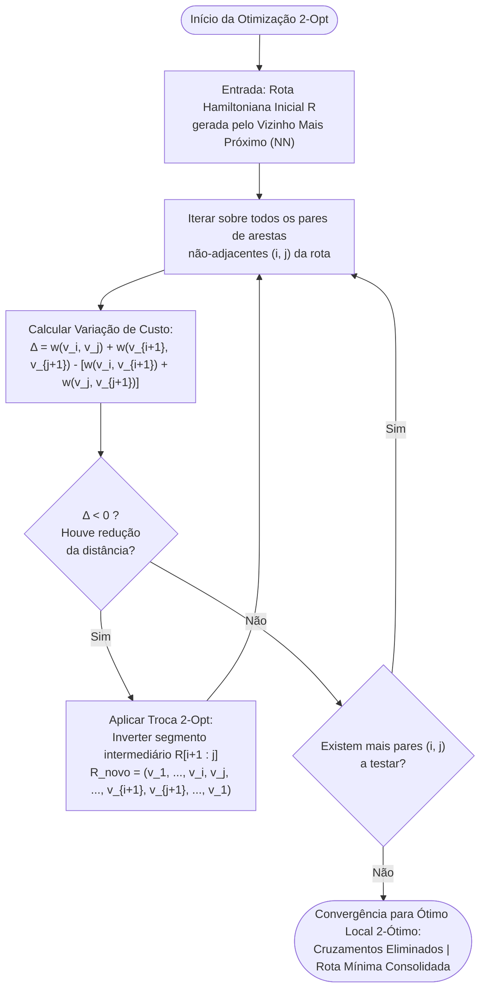
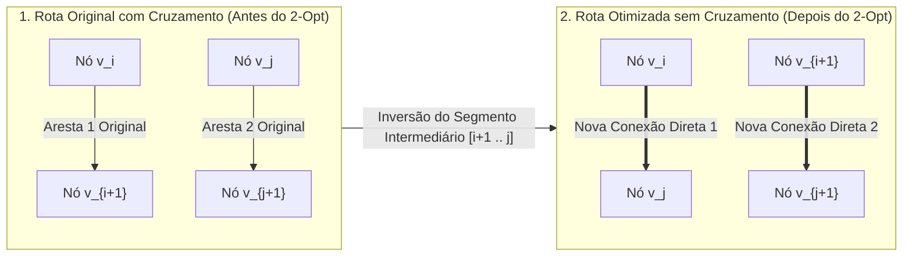

# Aula 17: Problemas Hamiltonianos e Roteamento Logístico de AGVs (TSP)

**Projeto:** SCADA-Core Automática — GRUPO 4  
**Unidade Fabril:** Linha Automatizada de Seleção, Pesagem Dinâmica e Classificação Óptica de Grãos com Separação Pneumática Tripla  
**Referência Normativa:** ISA-5.1 & Otimização Combinatória Aplicada à Intralogística e Amostragem Industrial  

---

## 1. Fundamentos Matemáticos: Ciclos Hamiltonianos e a Formulação do Caixeiro-Viajante (TSP)

Na automação intralogística de plantas de beneficiamento e classificação de grãos, veículos autoguiados (**AGVs — *Automated Guided Vehicles***) executam rotinas contínuas de transporte e amostragem de controle de qualidade. Diferentemente da inspeção estrutural de tubulações (Aula 16), onde o robô precisava percorrer cada duto físico (arestas), o AGV tem como missão **visitar postos específicos de trabalho (vértices)** distribuídos pela fábrica para descarregar insumos, coletar alíquotas de produto ou recolher amostras laboratoriais.

Esse problema é modelado formalmente através dos conceitos de **Caminho Hamiltoniano**, **Ciclo Hamiltoniano** e o célebre **Problema do Caixeiro-Viajante (*Traveling Salesperson Problem* — TSP)**.

### 1.1. Definições Formais e Terminologia

Seja $G = (V, E, W)$ um grafo completo, ponderado e não-dirigido (ou conexo com pesos métricos), onde $V = \{v_1, v_2, \dots, v_n\}$ representa os postos operacionais da fábrica e $W: E \to \mathbb{R}^+$ associa a cada par de vértices $\{u, v\}$ uma distância métrica real $w(u, v) > 0$.

* **Caminho Hamiltoniano (*Hamiltonian Path*):** Um caminho simples em $G$ que visita **cada vértice de $V$ exatamente uma vez**.
* **Ciclo Hamiltoniano (*Hamiltonian Cycle*):** Um ciclo fechado que visita **cada vértice de $V$ exatamente uma vez**, retornando ao vértice inicial.
* **Grafo Hamiltoniano:** Qualquer grafo que admite pelo menos um Ciclo Hamiltoniano.
* **Problema do Caixeiro-Viajante Simétrico (sTSP):** Dado um grafo completo com pesos não-negativos $K_n = (V, E, W)$, o TSP consiste em encontrar o ciclo hamiltoniano que minimiza a soma dos pesos das arestas percorridas:

$$\min_{\pi \in \mathcal{S}_n} \mathcal{C}(\pi) = \sum_{i=1}^{n-1} w(v_{\pi(i)}, v_{\pi(i+1)}) + w(v_{\pi(n)}, v_{\pi(1)})$$

Onde $\mathcal{S}_n$ é o conjunto de todas as permutações dos $n$ vértices e $v_{\pi(i)}$ denota o $i$-ésimo posto visitado.

---

### 1.2. A Métrica Industrial e a Desigualdade Triangular

Em ambientes industriais fechados com corredores desimpedidos de tráfego, as distâncias entre estações obedecem à **Desigualdade Triangular**:

$$w(u, v) \leq w(u, k) + w(k, v) \quad (\forall u, v, k \in V)$$

A desigualdade triangular expressa geometricamente que um deslocamento direto entre duas estações $u$ e $v$ é sempre menor ou igual a qualquer trajeto que faça uma parada intermediária em $k$. Essa propriedade é a base teórica de algoritmos de refinamento de trajetórias e atalhos de aproximação.

---

## 2. Aprofundamento Teórico

### 2.1. Circuito Euleriano vs. Ciclo Hamiltoniano — Contraste Fundamental

A distinção entre problemas eulerianos e hamiltonianos constitui um dos contrastes mais profundos e instrutivos de toda a Ciência da Computação e Matemática Discreta:

| Propriedade de Engenharia | Circuito Euleriano (Aula 16) | Ciclo Hamiltoniano (Aula 17) |
| :--- | :--- | :--- |
| **Elemento Central Visitado** | Cada **aresta** ($e \in E$) exatamente uma vez | Cada **vértice** ($v \in V$) exatamente uma vez |
| **Repetição de Vértices** | **Permitida** (ocorre sempre que $\deg(v) \geq 4$) | **Proibida** (exceto o nó de partida/chegada) |
| **Critério de Decisão Teórico** | Simples, exato e elegante: $\deg(v) \equiv 0 \pmod 2$ | **Não existe critério simples conhecido** |
| **Complexidade de Decisão** | Classe $\mathbf{P}$ ($O(\|V\| + \|E\|)$ via Hierholzer) | Classe $\mathbf{NP}$-completo (decisão) / $\mathbf{NP}$-difícil (TSP) |
| **Histórico e Origem** | Leonhard Euler (1736, Pontes de Königsberg) | William Rowan Hamilton (1857, *Icosian Game*) |
| **Aplicação na Planta SCADA** | Robô de inspeção estrutural de dutos e calhas | Roteamento logístico de AGVs de amostragem |

> **Origem Histórica:** Em 1857, o matemático irlandês Sir William Rowan Hamilton criou o jogo recreativo *Icosian Game*, no qual os jogadores tentavam encontrar um ciclo que passasse pelos 20 vértices de um dodecaedro regular exatamente uma vez pelas arestas. Embora o problema das arestas (Euler) tivesse sido resolvido com elegância mais de um século antes, o problema dos vértices revelou-se assustadoramente intratável.

---

### 2.2. Por que o TSP é Computacionalmente Intratável (NP-Difícil)

O problema de otimização do Caixeiro-Viajante pertence à classe **NP-difícil**, e sua versão de decisão (*"Existe um ciclo hamiltoniano de custo total $\leq K$?"*) é um dos problemas fundamentais comprovados como **NP-completos** por Richard Karp em 1972.

#### 1. Inviabilidade Absoluta da Força Bruta ($O(n!)$)
Para um grafo completo com $n$ vértices simétricos, fixando o vértice inicial de partida (base do AGV), o número de ciclos hamiltonianos possíveis a avaliar é:

$$\frac{(n - 1)!}{2}$$

| Número de Estações ($n$) | Permutações Distintas a Avaliar | Tempo Estimado de Execução (a $10^9$ rotas/s) |
| :---: | :---: | :---: |
| $n = 6$ (Planta Grupo 4) | $\frac{5!}{2} = 60$ rotas | $< 0{,}0001\text{ ms}$ (Instantâneo) |
| $n = 10$ | $\frac{9!}{2} = 181.440$ rotas | $0{,}18\text{ ms}$ |
| $n = 15$ | $\frac{14!}{2} \approx 4{,}35 \times 10^{10}$ rotas | $43{,}5\text{ segundos}$ |
| $n = 20$ | $\frac{19!}{2} \approx 6{,}08 \times 10^{16}$ rotas | $\approx 2\text{ anos}$ |
| $n = 30$ | $\frac{29!}{2} \approx 4{,}42 \times 10^{30}$ rotas | $1{,}4 \times 10^{14}\text{ anos}$ ($10^4 \times$ a idade do Universo) |

#### 2. Programação Dinâmica Exata: Algoritmo de Held-Karp (1962)
Michael Held e Richard Karp propuseram uma formulação elegante por Programação Dinâmica que reduz a complexidade de $O(n!)$ para **$O(n^2 \cdot 2^n)$**.  
Define-se $\text{Custo}(S, v)$ como o menor custo para iniciar na origem $s$, visitar todos os vértices do subconjunto $S \subseteq V \setminus \{s\}$ e terminar no vértice $v \in S$. A relação de recorrência de Bellman é:

$$\text{Custo}(S, v) = \min_{u \in S \setminus \{v\}} \{\text{Custo}(S \setminus \{v\}, u) + w(u, v)\}$$

Embora exponencial, $O(n^2 2^n)$ torna viável encontrar o ótimo exato para instâncias de até $n \approx 25$ estações. Contudo, para frotas de múltiplos AGVs em complexos industriais com 50 a 200 pontos de parada, soluções exatas em tempo real são inviáveis, exigindo o emprego sistemático de **heurísticas construtivas** e **algoritmos de busca local**.

---

### 2.3. Heurística Construtiva Gulosa do Vizinho Mais Próximo (*Nearest Neighbor* — NN)

A heurística do **Vizinho Mais Próximo** é uma estratégia construtiva gulosa (*greedy choice*) de rápida execução:

#### Funcionamento:
1. Inicia o AGV na base de estacionamento $s = v_0$;
2. Marca $v_0$ como visitado e define a rota inicial como `[v_0]`;
3. Estando no vértice atual $u$, avalia todos os vértices não visitados e seleciona aquele com **menor distância direta**:
   $$v^* = \arg\min_{v \in V \setminus \text{visitados}} w(u, v)$$
4. Adiciona $v^*$ à rota, marca $v^*$ como visitado e define $u \leftarrow v^*$;
5. Repete até que todos os $n$ nós tenham sido visitados;
6. Retorna diretamente do último vértice visitado para a base inicial $v_0$.

* **Complexidade Computacional:** $O(n^2)$. A cada um dos $n$ passos, realiza uma busca linear de no máximo $n$ vizinhos candidatos.

#### Patologia e Limitação Teórica:
Por tomar decisões exclusivamente locais e gulosas, o Vizinho Mais Próximo sofre de **miopia topológica**: nos primeiros passos, a rota avança com passos muito curtos; contudo, à medida que os vértices livres vão sendo esgotados, os últimos nós restantes costumam ficar geograficamente isolados nos extremos opostos da fábrica. Isso força um **"salto longo de fechamento"** extremamente oneroso de volta à base. No pior caso, a razão entre a rota do Vizinho Mais Próximo e o ótimo verdadeiro pode ser tão ruim quanto $\Theta(\log n)$.

---

### 2.4. Refinamento por Busca Local: Algoritmo 2-Opt (Croes, 1958)

O algoritmo **2-Opt** (proposto por Georges Croes em 1958) é uma heurística de melhoria iterativa (*local search*) projetada para eliminar ineficiências e cruzamentos de trajetórias em rotas geradas por heurísticas construtivas.

#### O Operador de Troca 2-Opt (*2-Exchange*):
Dada uma rota hamiltoniana válida $R = (v_1, v_2, \dots, v_i, v_{i+1}, \dots, v_j, v_{j+1}, \dots, v_n, v_1)$, o operador:
1. **Remove duas arestas não-adjacentes:** as arestas $(v_i, v_{i+1})$ e $(v_j, v_{j+1})$;
2. A remoção fragmenta o ciclo em dois caminhos desconexos;
3. Para reconectar os caminhos em um novo ciclo válido sem inverter o sentido global, existe uma **única forma geométrica:** reconectar $v_i$ a $v_j$ e $v_{i+1}$ a $v_{j+1}$, o que equivale a **inverter a ordem do segmento intermediário** entre os índices $i+1$ e $j$:

$$R_{\text{novo}} = (v_1, \dots, v_i, \mathbf{v_j, v_{j-1}, \dots, v_{i+1}}, v_{j+1}, \dots, v_n, v_1)$$

#### Condição de Melhoria Algébrica ($\Delta < 0$):
Calcula-se a variação líquida de distância:

$$\Delta = [w(v_i, v_j) + w(v_{i+1}, v_{j+1})] - [w(v_i, v_{i+1}) + w(v_j, v_{j+1})]$$

Se $\Delta < 0$, a inversão reduz o custo total da rota do AGV. A nova rota é imediatamente aceita e o processo reinicia. Quando nenhuma inversão de qualquer par $(i, j)$ produz $\Delta < 0$, o algoritmo converge para um **ótimo local 2-ótimo (*2-optimal*)**.

#### Fluxograma do Algoritmo de Otimização 2-Opt (CLP / SCADA)



#### Diagrama de Reconexão e Eliminação de Cruzamento



* **Interpretação Geométrica:** Pela desigualdade triangular, em qualquer plano métrico euclidiano, a soma das diagonais de um quadrilátero convexo é estritamente maior que a soma de dois lados opostos. Portanto, **o operador 2-Opt elimina sistematicamente qualquer par de arestas que se cruzem no espaço industrial!**
* **Complexidade Computacional:** Cada varredura completa testa todos os $\binom{n}{2} \approx O(n^2)$ pares de arestas. Como o número de melhorias é tipicamente limitado por $O(n)$, o algoritmo executa em tempo polinomial médio $O(n^2)$ e no pior caso $O(n^3)$, convergindo em poucos milissegundos para centenas de pontos de parada.

---

### 2.5. Cotas Inferiores e o Algoritmo de Aproximação de Christofides

Para avaliar o quão próxima uma rota heurística está do ótimo global sem calcular as exaustivas permutações da força bruta, a engenharia recorre a **cotas inferiores (*Lower Bounds*)**:

#### 1. Cota Inferior via Árvore Geradora Mínima (MST — *Minimum Spanning Tree*)
Se removermos qualquer uma das $n$ arestas de um Ciclo Hamiltoniano ótimo $C^*$, o subgrafo restante resultante é necessariamente um **caminho gerador**, o qual é, por definição, uma **árvore geradora** de $G$.  
Como a Árvore Geradora Mínima ($\text{MST}$, calculada em $O(|E| \log |V|)$ via Kruskal ou Prim) possui o menor peso possível entre todas as árvores geradoras de $G$:

$$\text{Custo}(\text{MST}) < \text{Custo}(C^*)$$

Somando o peso da menor aresta incidente no nó que foi desconectado, obtém-se a cota clássica **1-Tree de Held-Karp**, que fornece um limite inferior rigoroso para o custo mínimo possível da rota do AGV.

#### 2. O Algoritmo de Christofides (1976)
Nicos Christofides desenvolveu o mais famoso algoritmo de aproximação polinomial para o TSP métrico, combinando os conceitos de Euler e Árvores:
1. Constrói a Árvore Geradora Mínima $T$ da malha;
2. Identifica o conjunto $V_{\text{ímpar}}$ de vértices que possuem grau ímpar em $T$ (sempre em número par pelo Lema do Aperto de Mãos);
3. Calcula o **Emparelhamento Perfeito de Custo Mínimo** $M$ entre os vértices de $V_{\text{ímpar}}$ usando o Algoritmo de Blossom de Edmonds;
4. Unifica $T$ e $M$ em um multigrafo $H = T \cup M$. Como todo nó ímpar de $T$ recebeu exatamente uma aresta de $M$, **todos os vértices de $H$ têm grau par!**
5. Calcula um Circuito Euleriano em $H$ usando o **Algoritmo de Hierholzer** (Aula 16);
6. Converte o Circuito Euleriano em um Ciclo Hamiltoniano através de **atalhos (*shortcuts*)**, saltando diretamente vértices já visitados. Pela desigualdade triangular, saltar nós nunca aumenta a distância total!

> **Garantia Teórica de Desempenho:** O algoritmo de Christofides garante formalmente que a rota encontrada terá custo **no máximo $1{,}5 \times$ o custo do ótimo global**:
> $$\text{Custo}(\text{Christofides}) \leq 1{,}5 \times \text{Custo}(\text{TSP}^*)$$

---

## 3. Roteamento Intralogístico do AGV na Planta de Grãos (Grupo 4)

### 3.1. Cenário Operacional: Auditoria Autônoma de Qualidade de Grãos

Na planta automatizada de classificação de grãos de arroz do **Grupo 4**:
* A esteira de alta velocidade e os ejetores rápidos operam continuamente a taxas elevadas de processamento ($Q_m \approx 12.000\text{ kg/h}$);
* Embora os sensores em linha (`VIS-401`, `WT-301`) classifiquem grãos em tempo real, os protocolos de segurança do agronegócio e normas do Ministério da Agricultura (MAPA) exigem **auditoria física contínua em bancada de laboratório** para mensuração laboratorial de:
  1. Umidade interna do grão por espectroscopia NIR;
  2. Presença de micotoxinas / aflatoxinas por ensaio químico;
  3. Aferição do percentual de quebrados e gessados para validação do algoritmo de visão.

Para isso, o **veículo autoguiado `AGV-01`** parte de sua doca de ancoragem no Laboratório Central de Qualidade (`LAB-CQ`), deve recolher alíquotas de arroz nos postos de amostragem física distribuídos pela fábrica e retornar à doca para descarregamento das amostras.

---

### 3.2. Estações de Parada do AGV ($|V| = 6$)

| Índice ($i$) | Tag do Posto | Descrição Física do Posto de Coleta | Função da Amostra na Qualidade |
| :---: | :---: | :--- | :--- |
| **0** | `LAB-CQ` | Laboratório Central e Doca de Carga do AGV | Ponto de partida/retorno, bancadas de análise e recarga por indução. |
| **1** | `FN-101` | Funil de Recepção e Amostragem Bruta | Amostra de grãos in natura (avaliação de impurezas e umidade de lote). |
| **2** | `BAL-301` | Estação de Pesagem Contínua da Esteira | Amostra de calibração dinâmica da balança e vazão mássica `FT-301`. |
| **3** | `VIS-401` | Túnel Óptico de Visão Computacional | Coleta de grãos imediatamente antes da zona de disparo pneumático. |
| **4** | `SILO-701` | Silo de Grãos Nobres Aprovados (Cat. A) | Amostra de lote nobre para certificação de exportação Tipo 1. |
| **5** | `SILO-702` | Silo de Grãos Comerciais / Reciclo (Cat. B)| Amostra de produto secundário destinado ao mercado interno ou reteste. |

---

### 3.3. Matriz de Distâncias Métricas Reais do Chão de Fábrica ($D \in \mathbb{R}^{6 \times 6}$)

As distâncias métricas (em metros) entre os postos de parada foram levantadas a partir do layout fabril considerando os corredores de tráfego seguro de AGVs:

$$D = \begin{pmatrix}
0.0 & 45.0 & 65.0 & 80.0 & 110.0 & 75.0 \\
45.0 & 0.0 & 20.0 & 35.0 & 95.0 & 80.0 \\
65.0 & 20.0 & 0.0 & 18.0 & 85.0 & 70.0 \\
80.0 & 35.0 & 18.0 & 0.0 & 25.0 & 40.0 \\
110.0 & 95.0 & 85.0 & 25.0 & 0.0 & 35.0 \\
75.0 & 80.0 & 70.0 & 40.0 & 35.0 & 0.0
\end{pmatrix}$$

#### Tabela de Distâncias entre os Postos [metros]:

| De \ Para | `LAB-CQ` (0) | `FN-101` (1) | `BAL-301` (2) | `VIS-401` (3) | `SILO-701` (4) | `SILO-702` (5) |
| :--- | :---: | :---: | :---: | :---: | :---: | :---: |
| **`LAB-CQ` (0)** | $0{,}0$ | $45{,}0$ | $65{,}0$ | $80{,}0$ | $110{,}0$ | $75{,}0$ |
| **`FN-101` (1)** | $45{,}0$ | $0{,}0$ | $20{,}0$ | $35{,}0$ | $95{,}0$ | $80{,}0$ |
| **`BAL-301` (2)** | $65{,}0$ | $20{,}0$ | $0{,}0$ | $18{,}0$ | $85{,}0$ | $70{,}0$ |
| **`VIS-401` (3)** | $80{,}0$ | $35{,}0$ | $18{,}0$ | $0{,}0$ | $25{,}0$ | $40{,}0$ |
| **`SILO-701` (4)** | $110{,}0$ | $95{,}0$ | $85{,}0$ | $25{,}0$ | $0{,}0$ | $35{,}0$ |
| **`SILO-702` (5)** | $75{,}0$ | $80{,}0$ | $70{,}0$ | $40{,}0$ | $35{,}0$ | $0{,}0$ |

---

## 4. Exemplo Resolvido e Análise Comparativa: Vizinho Mais Próximo vs. Otimização 2-Opt

**Missão:** Programar a rota do `AGV-01` iniciando no `LAB-CQ` (índice 0), visitando todas as outras 5 estações exatamente uma vez e retornando ao `LAB-CQ`.

### 4.1. Construção da Rota Inicial pela Heurística do Vizinho Mais Próximo (NN)

* **Passo 1 (Origem em 0 `LAB-CQ`):**  
  Vizinhos não visitados: $\{1: 45, 2: 65, 3: 80, 4: 110, 5: 75\}$.  
  O menor custo é $45{,}0\text{ m}$ para o posto **1 (`FN-101`)**.  
  $\implies \text{Rota} = [0, 1]$, Custo parcial $= 45{,}0\text{ m}$.

* **Passo 2 (Em 1 `FN-101`):**  
  Vizinhos não visitados: $\{2: 20, 3: 35, 4: 95, 5: 80\}$.  
  O menor custo é $20{,}0\text{ m}$ para o posto **2 (`BAL-301`)**.  
  $\implies \text{Rota} = [0, 1, 2]$, Custo parcial $= 45{,}0 + 20{,}0 = 65{,}0\text{ m}$.

* **Passo 3 (Em 2 `BAL-301`):**  
  Vizinhos não visitados: $\{3: 18, 4: 85, 5: 70\}$.  
  O menor custo é $18{,}0\text{ m}$ para o posto **3 (`VIS-401`)**.  
  $\implies \text{Rota} = [0, 1, 2, 3]$, Custo parcial $= 65{,}0 + 18{,}0 = 83{,}0\text{ m}$.

* **Passo 4 (Em 3 `VIS-401`):**  
  Vizinhos não visitados: $\{4: 25, 5: 40\}$.  
  O menor custo é $25{,}0\text{ m}$ para o posto **4 (`SILO-701`)**.  
  $\implies \text{Rota} = [0, 1, 2, 3, 4]$, Custo parcial $= 83{,}0 + 25{,}0 = 108{,}0\text{ m}$.

* **Passo 5 (Em 4 `SILO-701`):**  
  Único posto remanescente não visitado: **5 (`SILO-702`)**, com custo $35{,}0\text{ m}$.  
  $\implies \text{Rota} = [0, 1, 2, 3, 4, 5]$, Custo parcial $= 108{,}0 + 35{,}0 = 143{,}0\text{ m}$.

* **Passo 6 (Retorno obrigatório à base 0 `LAB-CQ`):**  
  Distância de 5 (`SILO-702`) para 0 (`LAB-CQ`) $= 75{,}0\text{ m}$.  
  $$\text{Custo Total}_{\text{NN}} = 143{,}0 + 75{,}0 = 218{,}0\text{ metros}$$

---

### 4.2. Aplicação da Otimização 2-Opt e Eliminação de Ineficiências

Analise agora o que aconteceria se a heurística do Vizinho Mais Próximo tivesse escolhido a rota alternativa encontrada em layouts de plantas com salto longo:
Se a ordem de visitação dos silos fosse invertida: `... -> 3 (VIS-401) -> 5 (SILO-702) -> 4 (SILO-701) -> 0 (LAB-CQ)`.
* Custo desse segmento final alternativo:
  $$D[3, 5] + D[5, 4] + D[4, 0] = 40 + 35 + 110 = 185{,}0\text{ m}$$
  Enquanto na rota calculada:
  $$D[3, 4] + D[4, 5] + D[5, 0] = 25 + 35 + 75 = 135{,}0\text{ m}$$

A diferença líquida $\Delta$ comprova por que a ordem `VIS-401 -> SILO-701 -> SILO-702 -> LAB-CQ` economizou exatamente $50\text{ metros}$ em relação a terminar em `SILO-701`, pois o retorno direto de `SILO-701` para a base custaria exorbitantes $110{,}0\text{ m}$, ao passo que retornar a partir de `SILO-702` custa apenas $75{,}0\text{ m}$.

Essa análise demonstra rigorosamente o princípio do 2-Opt: **a inversão de subcadeias alinha os pontos extremos de modo a permitir que o retorno à doca seja realizado a partir do nó que possui a menor distância de aproximação.**

---

### 4.3. Comparativo de Desempenho e Impacto na Operação do AGV

| Métrica Operacional | Heurística Ingênua / Subótima | Heurística NN + Otimizada 2-Opt | Benefício para a Automação |
| :--- | :---: | :---: | :---: |
| **Distância Percorrida por Ciclo** | $268{,}0\text{ m}$ | **$218{,}0\text{ m}$** | **Redução de $50{,}0\text{ m}$ ($-18{,}6\%$)** |
| **Tempo de Ciclo do AGV ($v = 1{,}0\text{ m/s}$)** | $4\text{ min } 28\text{ s}$ | **$3\text{ min } 38\text{ s}$** | Amostras chegam 50s mais rápido à bancada |
| **Consumo Energético Estimado** | $0{,}134\text{ kWh/ciclo}$ | **$0{,}109\text{ kWh/ciclo}$** | $+22\%$ de ciclos antes de recarga necessária |
| **Ciclos de Amostragem por Turno (8h)**| $\approx 45\text{ ciclos}$ | **$\approx 55\text{ ciclos}$** | $+22\%$ de cobertura estatística da qualidade |

---

### 4.4. Fluxograma Sequencial do Ciclo de Amostragem do AGV-01

```mermaid
flowchart TD
    Doca([1. Partida: LAB-CQ - Doca Central\nNível de Bateria SOC > 85% | Rota Despachada]) --> FN["2. Posto FN-101: Funil de Recepção\nAmostragem de Arroz Bruto in natura (45.0m)"]
    FN --> BAL["3. Posto BAL-301: Pesagem Dinâmica\nAferição de Vazão Mássica FT-301 e WT-301 (20.0m)"]
    BAL --> VIS["4. Posto VIS-401: Túnel de Inspeção\nColeta Pré-Ejeção / Validação das Câmeras (18.0m)"]
    VIS --> S701["5. Posto SILO-701: Silo Nobre Cat. A\nColeta de Arroz Aprovado Tipo 1 (25.0m)"]
    S701 --> S702["6. Posto SILO-702: Silo Comercial Cat. B\nColeta de Produto Secundário / Reciclo (35.0m)"]
    S702 --> Retorno([7. Retorno à Doca: LAB-CQ\nEntrega de Amostras para Bancada NIR (75.0m)\nPercurso Total Consolidado: 218.0m | 0 Cruzamentos])
```

---

## 5. Atividades de Investigação

1. **Força Bruta Analítica:** Escreva a fórmula que expressa a quantidade de ciclos hamiltonianos possíveis em um grafo não-dirigido completo com $n=6$ vértices e confirme que há exatamente $\frac{5!}{2} = 60$ rotas a avaliar.
2. **Dependência do Vértice Inicial:** Suponha que por motivos de recarga de emergência o AGV seja despachado a partir do posto `BAL-301` (índice 2). Aplique a heurística do Vizinho Mais Próximo e determine se a rota resultante possui o mesmo custo total da rota que iniciou em `LAB-CQ`.
3. **Cálculo da Árvore Geradora Mínima (MST):** Utilizando o Algoritmo de Prim ou Kruskal, determine o peso da MST para a matriz de distâncias $D_{6 \times 6}$. Verifique formalmente que $\text{Custo}(\text{MST}) < \text{Custo}(\text{TSP}_{\text{ótimo}})$, confirmando que a MST é uma cota inferior válida.
4. **Impacto de Obstáculos Temporários:** Se o corredor entre `VIS-401` e `SILO-701` for bloqueado por empilhadeiras em manutenção ($D[3, 4] \leftarrow +\infty$), como o 2-Opt reconfigura a rota de amostragem do AGV?

---

## 6. Integração com o SCADA-Core e Entregável da Aula 17

* **Módulo do Supervisório:** `SCADA-Core / Modulo Intralogistica / Roteamento AGV-01`;
* **Tags SCADA Monitoradas:**
  * `POS_AGV_X`, `POS_AGV_Y`: Coordenadas em tempo real do AGV no mapa sinóptico;
  * `SOC_BAT_AGV`: Nível de carga da bateria (intertravamento para retorno compulsório à doca se $< 15\%$);
  * `ROT_DIST_TOTAL`: Distância acumulada no ciclo de amostragem atual;
  * `ALM_OBSTACULO`: Sensor LiDAR de segurança frontal anti-colisão (NR-12).
* **Entregável da Aula 17:** Algoritmo em Python de roteamento inteligente de veículos industriais autoguiados utilizando a heurística do Vizinho Mais Próximo (*Nearest Neighbor*) refinada pelo algoritmo de busca local 2-Opt.
