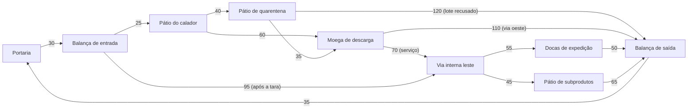

# Aula 18: Grafos de Logística de Grãos, Processo e Produtos Acabados

**Projeto:** SCADA-Core Automática — GRUPO 4  
**Unidade Fabril:** Linha Automatizada de Seleção, Pesagem Dinâmica e Classificação Óptica de Grãos com Separação Pneumática Tripla  
**Referência Normativa:** ISA-5.1 & Teoria dos Grafos Aplicada à Logística Interna, Rastreabilidade e Segurança de Alimentos  

---

## 1. Situação-problema

Nas Aulas 11 a 15, a planta foi representada pela **malha de processo**: funil `FN-101`, calha vibratória, esteira, balança dinâmica, túnel óptico, ejetores pneumáticos e silos. Nas Aulas 16 e 17, a mesma planta ganhou duas redes de serviço: a malha de dutos inspecionada pelo robô (circuito euleriano) e a rota de amostragem do `AGV-01` (ciclo hamiltoniano).

A operação industrial completa ainda exige responder **como o arroz chega à linha de classificação** e **como o produto classificado chega à expedição**. A imagem [Grafo_Logistica.png](./Grafo_Logistica.png) apresenta o layout esquemático da fábrica e identifica:

* portaria, balança de entrada e balança de saída;
* pátio do calador (amostragem do lote no caminhão) e pátio de quarentena;
* moega de descarga `MG-001` e silos pulmão `SP-001` e `SP-002`;
* o prédio de classificação óptica com a linha `FN-101` $\to$ `CALHA-701` da Aula 11;
* os silos de produto `SILO-701` (Cat. A), `SILO-702` (Cat. B) e `SILO-703` (Cat. C);
* o Galpão B, com empacotadora `EMP-801`, paletizadora `PAL-801`, ensacadora de big bags `BIG-802`, Estoque Tipo 1, Estoque Tipo 2 e as docas de expedição;
* o pátio de subprodutos com a caçamba `CAC-803`;
* a rota do `AGV-01` da Aula 17 e o reciclo $e_{14}$ das Aulas 11 a 13.

O objetivo desta aula é construir grafos que conectem esses setores ao processo de classificação descrito na [Etapa 01](../etapa-01-logica/00%20-%20Descritivo%20Do%20Processo.md), **sem confundir fluxos fisicamente diferentes**.

> **Nota metodológica:** os comprimentos fora da linha de classificação são estimativas didáticas para comparação de rotas. A imagem é uma planta esquemática e não deve ser usada para medir distâncias operacionais reais. Os pesos da linha `FN-101` $\to$ silos são exatamente os comprimentos da Aula 11 ($e_1$ a $e_{13}$).

---

## 2. Fundamentos Teóricos: Grafos Acíclicos Dirigidos e Redes Multicamada

### 2.1. Por que o Fluxo Normal de Materiais é um DAG

Na malha de processo das Aulas 11 a 15 existe o ciclo de reciclo $e_{14}$ (`SILO-702` $\to$ `FN-101`). Já o **fluxo normal de materiais** $G_M$ desta aula — do recebimento até a expedição, com a comporta de reteste `XV-104` fechada — é, por definição de processo, um **Grafo Acíclico Dirigido (DAG — *Directed Acyclic Graph*)**: cada etapa (descarga, classificação, empacotamento, paletização) é irreversível dentro do fluxo normal de produção.

**Definição formal:** um dígrafo $G=(V,E)$ é um DAG se não existe nenhum ciclo dirigido, ou seja, não existe sequência $v_0, v_1, \dots, v_k = v_0$ com $(v_{i-1}, v_i) \in E$ para todo $i$.

**Propriedade fundamental (ordenação topológica):** todo DAG admite pelo menos uma **ordenação topológica** $\text{ord}: V \rightarrow \{1, \dots, n\}$ tal que, para toda aresta $(u,v) \in E$, $\text{ord}(u) < \text{ord}(v)$. Essa propriedade torna o grafo **auditável**: o SCADA consegue verificar se uma sequência registrada é fisicamente possível. Por exemplo, o modelo não permite que `Empacotadora EMP-801` ocorra antes de `VIS-401`, porque `VIS-401` é antecessor da empacotadora em $G_M$.

> **Observação:** a ordenação topológica de um DAG em geral **não é única**. Vértices sem relação de precedência entre si (como `Silo pulmão SP-001` e `Silo pulmão SP-002`) podem aparecer em qualquer ordem. Por isso a auditoria de uma sequência deve testar **alcançabilidade** (existe caminho do passo posterior para o anterior?), e não comparar posições em uma única ordenação.

**Algoritmo de Kahn (1962):** calcula uma ordenação topológica em $O(|V|+|E|)$ processando repetidamente vértices de grau de entrada zero, removendo-os do grafo e decrementando o grau de entrada de seus sucessores. Se, ao final, restarem vértices com grau de entrada positivo, o grafo **não** é um DAG. É um teste direto de aciclicidade, complementar à detecção de *back edges* por DFS estudada na Aula 13.

### 2.2. Redes Multicamada (*Multilayer Networks*)

Modelar **três grafos distintos** ($G_M$, $G_V$, $G_E$) sobre a mesma planta é um caso particular de **rede multicamada**: o mesmo espaço físico é representado por várias camadas de conexão, cada uma com um tipo de relação. Formalmente, $\mathcal{M} = (\{G_\alpha\}_{\alpha \in L}, \{E_{\alpha\beta}\})$, onde $L = \{\text{materiais}, \text{veículos}, \text{estoque}\}$ e $E_{\alpha\beta}$ são **arestas de acoplamento** entre camadas (por exemplo, `Moega MG-001` em $G_M$ e `Moega de descarga` em $G_V$ ocupam o mesmo espaço físico).

O motivo de **não colapsar tudo em um único grafo** é evitar um erro clássico: aplicar um algoritmo de uma camada para responder uma pergunta de outra. Um grão não "trafega" pela via interna leste, e um caminhão não "passa" pelo túnel óptico `VIS-401`. Misturar as arestas das camadas produziria rotas fisicamente inválidas. No notebook, consultas feitas na camada errada são **rejeitadas** pelo próprio modelo.

### 2.3. Cadeia de Suprimentos como Composição de Ferramentas da Etapa 02

| Subproblema da cadeia | Ferramenta da Etapa 02 aplicada |
| :--- | :--- |
| Representar equipamentos, trechos e pesos | Dígrafo ponderado e matrizes (Aulas 11 e 12) |
| Verificar se o rejeito alcança áreas de produto acabado | Alcançabilidade por BFS (Aula 13) |
| Menor rota de referência entre a portaria e cada estoque | Dijkstra (Aula 14) |
| Rota alternativa quando um transportador ou via é bloqueado | Reponderação / remoção de arco e novo Dijkstra (Aulas 14 e 15) |
| Pontos únicos de falha da expedição | Arcos críticos por remoção de arco (Aula 15) |
| Inspeção de todos os dutos e galerias | Circuito euleriano — Hierholzer (Aula 16) |
| Coleta de amostras em vários postos com retorno à base | TSP com NN + 2-Opt (Aula 17) |
| Auditar se a sequência de produção respeita a ordem física | Ordenação topológica e alcançabilidade em DAG (esta aula) |

Essa tabela resume o objetivo da Etapa 02: poucos algoritmos fundamentais (BFS, DFS, Dijkstra, Hierholzer, heurísticas de TSP, Kahn) respondem a praticamente todas as perguntas operacionais da planta — da esteira interna à logística de caminhões.

### 2.4. Limitações do Modelo com Peso Único

Os grafos desta aula usam um único escalar por arco (distância estimada). Em uma modelagem mais completa, cada arco poderia carregar um **vetor de custos** $\vec{w}(u,v) = (\text{distância}, \text{tempo}, \text{custo}, \text{risco sanitário})$, transformando o problema de menor caminho em um **problema multiobjetivo**, cuja resposta é uma **fronteira de Pareto** de rotas não-dominadas. Esse tópico é indicado como aprofundamento e foge do escopo desta etapa.

---

## 3. Três Grafos para o Mesmo Layout

| Grafo | Vértices | Arcos dirigidos | Peso | Pergunta respondida |
| :--- | :--- | :--- | :--- | :--- |
| $G_M$ — fluxo de materiais | setores, equipamentos, silos e estoques | transferência permitida de material | distância interna estimada (m) | Como o arroz que chega no caminhão alcança a doca como produto acabado? |
| $G_V$ — circulação de veículos | portaria, balanças, pátios, moega e docas | trecho de via autorizado em cada sentido | distância de circulação estimada (m) | Qual rota o graneleiro ou o caminhão de expedição pode percorrer? |
| $G_E$ — alocação de estoque | paletizadora, corredores, posições e docas | guarda e separação por empilhadeira | deslocamento da empilhadeira (m) | Em qual posição do Galpão B armazenar cada palete? |

O notebook desta aula implementa as três camadas. A mesma estrutura pode receber tempo, custo, emissões ou risco, desde que todos os pesos de uma mesma consulta representem a mesma grandeza.

---

## 4. Grafo Dirigido do Fluxo de Materiais ($G_M$)

$$G_M=(V_M,E_M,w_M), \qquad w_M:E_M\rightarrow\mathbb{R}_{\geq0}, \qquad |V_M| = 28, \quad |E_M| = 29 \text{ (sem } e_{14}\text{)}$$

```mermaid
flowchart LR
    P["Portaria"] -->|"30"| BE["Balança de entrada"]
    BE -->|"25"| CAL["Calador / amostragem"]
    CAL -->|"60"| MG["Moega MG-001"]
    MG -->|"35"| SP1["Silo pulmão SP-001"]
    MG -->|"42"| SP2["Silo pulmão SP-002"]
    SP1 -->|"30"| FN["FN-101"]
    SP2 -->|"20"| FN
    FN -->|"e1 a e6: 11,5 m"| EJ2["EJE-602"]
    EJ2 -->|"e7 + e12: 4,8 m"| S702["SILO-702 (Cat. B)"]
    EJ2 -->|"e8: 1,5"| EJ3["EJE-603"]
    EJ3 -->|"e10 + e11: 5,7 m"| S701["SILO-701 (Cat. A)"]
    EJ3 -->|"e9 + e13: 4,0 m"| S703["SILO-703 (Cat. C)"]
    S702 -.->|"e14: 12,0 (XV-104)"| FN
    S701 -->|"18"| EMP["Empacotadora EMP-801"]
    EMP -->|"12"| PAL["Paletizadora PAL-801"]
    PAL -->|"30"| T1["Estoque Tipo 1"]
    T1 -->|"25"| D["Docas de expedição"]
    S702 -->|"20"| BIG["Ensacadora BIG-802"]
    BIG -->|"26"| T2["Estoque Tipo 2"]
    T2 -->|"22"| D
    S703 -->|"15"| CAC["Caçamba CAC-803"]
    CAC -->|"40"| SUB["Saída de subprodutos"]
```

> No diagrama, a linha de classificação está **resumida** para legibilidade (somas dos arcos $e_1$ a $e_{13}$ da Aula 11). No notebook ela aparece completa, com os 9 equipamentos intermediários (`ALIM-101`, `EST-201`, `BAL-301`, `VIS-401`, `DIV-501`, `CALHA-602`, `CALHA-603`, `CALHA-701`). O arco tracejado $e_{14}$ só existe com a comporta `XV-104` aberta e é tratado separadamente na Seção 4.3.

As arestas de `Portaria` até `Moega MG-001` representam a liberação e a descarga física do caminhão graneleiro. A partir da moega, as arestas representam a transferência do grão por transportadores e elevadores. Assim, uma rota em $G_M$ é uma **rota operacional de referência**, e não uma alegação de que o mesmo caminhão percorre a linha de classificação.

### 4.1. Correspondência com as Categorias da Etapa 01

| Categoria (Etapa 01) | Silo | Destino logístico | Produto / uso |
| :--- | :--- | :--- | :--- |
| A — Produto Aprovado | `SILO-701` | `Empacotadora EMP-801` $\to$ `Paletizadora PAL-801` $\to$ `Estoque Tipo 1` | Arroz Tipo 1 em pacotes de 1 kg e 5 kg |
| B — Produto Secundário | `SILO-702` | `Ensacadora BIG-802` $\to$ `Estoque Tipo 2` (ou reteste via $e_{14}$) | Arroz comercial em big bags de 1 t |
| C — Produto Rejeitado | `SILO-703` | `Caçamba CAC-803` $\to$ `Saída de subprodutos` | Quirera e impurezas para ração animal / compostagem |

Os estoques Tipo 1 e Tipo 2 aparecem como vértices distintos para preservar a **rastreabilidade do lote** após o envase.

### 4.2. Rotas de Referência Calculadas pelo Notebook

| Destino | Silo de origem | Silo pulmão usado | Arcos | Distância (m) |
| :--- | :---: | :---: | :---: | :---: |
| `Estoque Tipo 1` | `SILO-701` | `SP-002` | 17 | 255,7 |
| `Estoque Tipo 2` | `SILO-702` | `SP-002` | 15 | 239,3 |
| `Docas de expedição` | `SILO-702` | `SP-002` | 16 | 261,3 |
| `Saída de subprodutos` | `SILO-703` | `SP-002` | 16 | 249,0 |

> **Atenção à interpretação:** a rota mais curta até as docas passa pelo `SILO-702`, mas isso **não** significa que o SCADA deva desviar grãos para a Categoria B. A categoria é decidida pela visão computacional (`VIS-401`). Por isso o notebook calcula a rota de referência até **cada** estoque, e não apenas a rota mais curta até a doca.

### 4.3. O Arco de Reciclo $e_{14}$ e a Ordenação Topológica

* **Sem reciclo (`XV-104` fechada):** o algoritmo de Kahn ordena os 28 vértices, comprovando que $G_M$ é um DAG.
* **Com reciclo (`XV-104` aberta):** `FN-101` recebe arcos de `SP-001`, `SP-002` e `SILO-702`. Depois que os dois silos pulmão são processados, `FN-101` ainda mantém grau de entrada $1$ (vindo de `SILO-702`), mas `SILO-702` depende do próprio `FN-101`. Nenhum vértice a jusante chega a grau zero: Kahn ordena apenas **6** vértices (`Portaria` até os silos pulmão) e trava nos **22** restantes. A DFS confirma o ciclo:
  $$\text{FN-101} \rightarrow \text{ALIM-101} \rightarrow \text{EST-201} \rightarrow \text{BAL-301} \rightarrow \text{VIS-401} \rightarrow \text{DIV-501} \rightarrow \text{EJE-602} \rightarrow \text{CALHA-602} \rightarrow \text{SILO-702} \rightarrow \text{FN-101}$$

**Conclusão de projeto:** o retrabalho não é uma falha de modelagem, mas precisa de uma **regra explícita de liberação** (por exemplo, laudo do `LAB-CQ` autorizando o reteste). A auditoria do fluxo normal é feita sobre $G_M$ sem $e_{14}$.

### 4.4. Segregação Sanitária do Rejeito

Requisito de segurança de alimentos: o material da Categoria C nunca pode alcançar áreas de produto acabado. Em termos de grafos, **não pode existir caminho dirigido** de `SILO-703` até `SILO-701`, `SILO-702`, `Estoque Tipo 1`, `Estoque Tipo 2` ou `Docas de expedição`. A BFS a partir de `SILO-703` alcança somente $\{\text{SILO-703}, \text{Caçamba CAC-803}, \text{Saída de subprodutos}\}$ — a rota de subprodutos é **segregada** e tem saída própria. Essa verificação responde formalmente à Atividade 3 da Aula 11.

### 4.5. Arcos Críticos da Expedição

Removendo cada arco isoladamente e testando se `Docas de expedição` continua alcançável a partir da `Portaria`, o notebook encontra **9 arcos críticos de 29**: os 3 arcos do recebimento (`Portaria` $\to$ `Balança de entrada` $\to$ `Calador` $\to$ `Moega MG-001`) e os 6 primeiros arcos da linha ($e_1$ a $e_6$, de `FN-101` até `EJE-602`). Os transportadores dos silos pulmão **não** são críticos: com o transportador `TC-002` em falha, o desvio automático via `SP-001` custa apenas $+3{,}0\text{ m}$ ($264{,}3\text{ m}$ contra $261{,}3\text{ m}$). Os arcos críticos são os candidatos prioritários a redundância ou a estoque de peças sobressalentes.

---

## 5. Grafo de Circulação de Veículos ($G_V$)

O fluxo de materiais é dirigido e não volta atrás sem regra de retrabalho. Já o anel viário tem trechos de sentido único: para cada sentido permitido, inclui-se um arco em $G_V$. Dois tipos de caminhão usam o anel: o **graneleiro** (traz arroz, para no calador e na moega) e o **caminhão de expedição** (chega vazio, faz a tara na balança de entrada e segue pela via interna leste até as docas, **sem passar pela área de descarga**).

### 5.1. Viagens Típicas (Dijkstra com Paradas Obrigatórias)

Uma viagem é uma sequência de paradas obrigatórias; entre duas paradas consecutivas aplica-se Dijkstra, e os trechos são concatenados.

| Viagem | Percurso calculado | Distância (m) |
| :--- | :--- | :---: |
| Graneleiro (lote aprovado) | Portaria $\to$ Balança de entrada $\to$ Pátio do calador $\to$ Moega $\to$ Balança de saída $\to$ Portaria | 260 |
| Graneleiro (lote em quarentena) | ... $\to$ Pátio do calador $\to$ Pátio de quarentena $\to$ Moega $\to$ ... | 275 |
| Graneleiro (lote recusado) | ... $\to$ Pátio do calador $\to$ Pátio de quarentena $\to$ Balança de saída $\to$ Portaria | 250 |
| Caminhão de expedição | Portaria $\to$ Balança de entrada $\to$ Via interna leste $\to$ Docas $\to$ Balança de saída $\to$ Portaria | 265 |
| Caminhão de subprodutos | Portaria $\to$ Balança de entrada $\to$ Via interna leste $\to$ Pátio de subprodutos $\to$ Balança de saída $\to$ Portaria | 270 |

### 5.2. O Anel Viário como Ciclo e a Conectividade Forte

Ao contrário de $G_M$, o grafo $G_V$ **contém ciclos por construção** (por exemplo, `Portaria` $\to$ ... $\to$ `Moega de descarga` $\to$ `Balança de saída` $\to$ `Portaria`). Isso reflete o fato de que o veículo entra e sai pelo mesmo ponto de controle.

O requisito de segurança viária é que **nenhum veículo fique preso**: todo vértice deve ser alcançável a partir da `Portaria` **e** alcançar a `Portaria`. O notebook verifica isso por BFS no grafo e no **grafo reverso**; como as duas buscas alcançam os 9 vértices, $G_V$ é **fortemente conexo**. Se a planta tivesse vários pontos de coleta a visitar numa mesma viagem, definir a ordem de visita seria exatamente o TSP da Aula 17.

### 5.3. Bloqueio Dinâmico de Via

Com a via `Pátio do calador` $\to$ `Moega de descarga` interditada para limpeza, o Dijkstra reencaminha o graneleiro pelo pátio de quarentena: $40 + 35 = 75\text{ m}$, contra $60\text{ m}$ nominais ($+15\text{ m}$), sem parada da recepção.

---

## 6. Grafo de Alocação de Estoque ($G_E$)

No Galpão B, o custo de manuseio de um palete é a soma do **deslocamento de guarda** (paletizadora $\to$ posição) com o **deslocamento de separação** (posição $\to$ docas):

$$c(p) = \delta_{G_E}(\text{PAL-801}, p) + \delta_{G_E}(p, \text{Docas})$$

Cada novo palete vai para a posição livre de menor $c(p)$; a posição ocupada tem seu arco de guarda removido e o próximo palete é realocado. Resultado do notebook para 4 paletes:

| Palete | Posição | Guarda (m) | Separação (m) | Custo total (m) |
| :---: | :---: | :---: | :---: | :---: |
| 1 | A3 | 30,0 | 15,0 | 45,0 |
| 2 | A2 | 22,0 | 24,0 | 46,0 |
| 3 | B3 | 37,0 | 9,0 | 46,0 |
| 4 | B2 | 29,0 | 18,0 | 47,0 |

Note que a posição mais próxima da paletizadora (A1, guarda de apenas $14\text{ m}$) não é a primeira escolhida, pois sua separação até as docas custa $34\text{ m}$. Novamente, o que importa é a **soma acumulada** do percurso.

---

## 7. Exemplo Resolvido

**Pergunta:** Por que a rota de menor custo de `Portaria` até `Docas de expedição` em $G_M$ passa pelo `Silo pulmão SP-002`, se o arco `Moega MG-001` $\to$ `SP-001` ($35\text{ m}$) é mais curto que `Moega MG-001` $\to$ `SP-002` ($42\text{ m}$)?

**Resolução:** O Dijkstra compara a **distância acumulada** até `FN-101`, e não apenas o primeiro arco após a moega:

$$\text{via SP-001: } 35 + 30 = 65\text{ m} \qquad \text{via SP-002: } 42 + 20 = 62\text{ m}$$

Como todo grão precisa chegar ao `FN-101` antes da classificação, a rota via `SP-002` economiza $3\text{ m}$. Somando o restante do percurso:

$$\underbrace{30 + 25 + 60}_{\text{recebimento}} + \underbrace{42 + 20}_{\text{SP-002}} + \underbrace{1{,}2 + 1{,}8 + 2{,}5 + 3{,}0 + 1{,}0 + 2{,}0 + 0{,}8 + 4{,}0}_{\text{linha até SILO-702 (Aula 11)}} + \underbrace{20 + 26 + 22}_{\text{big bag até as docas}} = 261{,}3\text{ m}$$

Escolher o pulmão pelo primeiro arco ("guloso") resultaria em $264{,}3\text{ m}$. Esse é o erro mais comum de quem está aprendendo Dijkstra: a decisão definitiva sobre um vértice só é tomada quando ele é **extraído** da fila de prioridade com a menor distância acumulada.

---

## 8. Integração do Módulo 2 — Roteador Automático de Fluidos e Logística

| Aula | Entregável | Papel no roteador integrado |
| :---: | :--- | :--- |
| 11 | `GrafoTubulacao` (dígrafo ponderado e graus) | Base topológica da linha de classificação usada em $G_M$ |
| 12 | `CalculadorIncidencia` ($B \cdot \vec{Q} = \vec{S}$) | Balanço de massa por nó para detectar perdas |
| 13 | `BuscadorTopologico` (BFS/DFS) | Alcançabilidade, segregação sanitária e detecção do ciclo $e_{14}$ |
| 14 | `RoteadorDijkstra` | Rotas de referência e reencaminhamento por bloqueio |
| 15 | `SimuladorVazamentosFalhas` | Injeção de falhas e arcos críticos |
| 16 | `GrafoInspecaoEuleriano` (Hierholzer) | Rota de inspeção do robô na malha de dutos |
| 17 | `RoteadorAGV_TSP` (NN + 2-Opt) | Rota de amostragem do `AGV-01` (sobreposta no layout) |
| 18 | `GrafoLogistico` ($G_M$, $G_V$, $G_E$) | Logística de recebimento, circulação e expedição |

---

## 9. Atividades de Investigação

1. Execute o notebook e identifique o caminho mínimo de `Portaria` até cada um dos três destinos de produto (`Estoque Tipo 1`, `Estoque Tipo 2`, `Saída de subprodutos`) em $G_M$. Confira os valores com a tabela da Seção 4.2.
2. Remova temporariamente o arco `Paletizadora PAL-801` $\to$ `Estoque Tipo 1`. O que o algoritmo informa para o destino `Estoque Tipo 1`? E para `Docas de expedição`? Relacione o resultado a uma indisponibilidade de área de armazenagem.
3. No $G_V$, remova o arco `Moega de descarga` $\to$ `Balança de saída` (via oeste interditada). O graneleiro ainda consegue sair da planta? Por qual rota, e com qual custo? $G_V$ continua fortemente conexo?
4. Substitua os pesos em metros por tempo médio (minutos), incluindo o tempo de espera na fila do calador e na pesagem. Explique por que uma rota mais curta em metros pode deixar de ser a melhor rota logística.
5. Inclua em $G_M$ um vértice `Pré-limpeza PL-001` entre a moega e os silos pulmão. Quais arcos críticos novos aparecem? Que redundância você proporia?
6. Adicione um arco `SILO-703` $\to$ `FN-101` (reprocessamento de rejeito). Mostre, pela BFS da Seção 4.4, que a segregação sanitária é violada, e proponha a regra de liberação que tornaria o arco aceitável.
7. Modele a logística **externa**: um caminhão sai das docas, entrega em 4 clientes e retorna à planta. Que algoritmo da Etapa 02 resolve a ordem de visitas? Reaproveite a classe `RoteadorAGV_TSP` da Aula 17.

---

## 10. Entregável da Aula 18

* **Modelo `GrafoLogistico` em Python** ([notebook da aula](./18%20-%20Grafos%20de%20Logistica%20de%20Insumos%20e%20Produtos%20Acabados.ipynb)): criação de rotas dirigidas e ponderadas, menor caminho por Dijkstra, rotas com paradas obrigatórias, ordenação topológica de Kahn, detecção de ciclo por DFS, verificação de segregação por BFS e análise de arcos críticos.
* **Três modelos coerentes** baseados nos setores mostrados em [Grafo_Logistica.png](./Grafo_Logistica.png): fluxo de materiais ($G_M$), circulação interna de veículos ($G_V$) e alocação de estoque ($G_E$).
* **Asserções formais:** 8 validações automáticas (passagem obrigatória pela inspeção óptica, soma acumulada no Dijkstra, segregação do rejeito, aciclicidade, auditoria de sequências, redundância dos silos pulmão, conectividade forte do anel viário e unicidade das posições de estoque).
